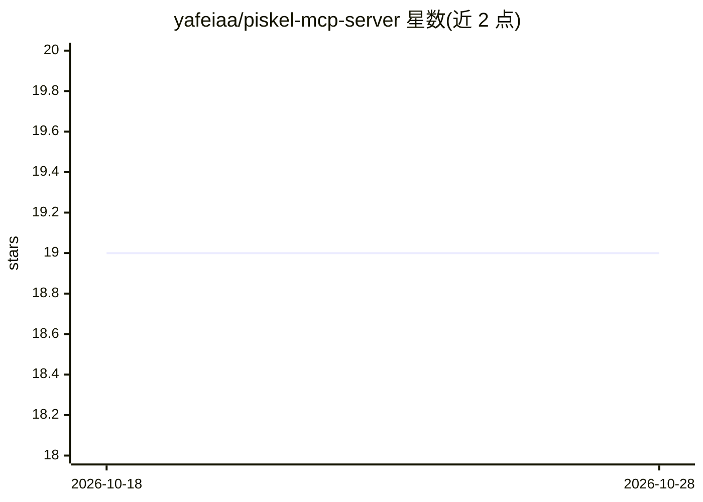

# yafeiaa/piskel-mcp-server

⭐ 19 · TypeScript · Apache-2.0 · 推送 2026-07-29 · [GitHub](https://github.com/yafeiaa/piskel-mcp-server) · [官网](https://yafeiaa.github.io/piskel-mcp-server/) · 个人维护 · 中文 README

**让 AI 助手通过 MCP 创建和操作像素画的工具服务器**

Piskel 像素画编辑器的 MCP（Model Context Protocol）服务器，供 AI 助手经 stdio 传输协议接入后用自然语言创作像素画。提供项目管理、图层与动画帧管理、像素/线条/矩形/圆形绘制、洪水填充、像素数据读取等 20 余个 MCP 工具，并支持导出 PNG、GIF 与雪碧图。以 Node.js 源码形式提供，需 git clone 后 npm install 并构建，配置到 Agent 的 mcpServers 中使用。

## 筛选速览

| 维度 | 判定 | 备注 |
|---|---|---|
| AI 角色 | `ai-ecosystem` | LLM/agent 周边工具 |
| 许可风险 | `permissive` | Apache-2.0 |
| 部署形态 | `library` | 以包/库形式分发 |
| 模型依赖 | — | README 未给出锁定关系 |
| 硬件要求 | — | 无带数字的原话,不猜 |
| 安装摩擦 | `low` | 无编译、无系统依赖或容器化 |
| 成熟度 | — | 结构信号不足 |

## 能力要点

- 20 余个 MCP 工具覆盖项目/图层/帧/绘图/导出
- stdio 传输协议接入 Agent，自然语言驱动创作
- 导出 PNG、GIF 与雪碧图三种格式
- 中英双语 README，Apache-2.0 许可

## 适用场景

- 让 Claude 等 MCP 客户端按自然语言指令生成游戏精灵图
- 通过对话迭代绘制与修改像素画动画帧
- 批量导出像素画资产用于游戏开发

## 场景标签

`图像生成` · 领域:内容生成

## 证据(README 行号)

> L6: Piskel 像素画编辑器的 MCP（Model Context Protocol）服务器，让 AI 助手能够通过 MCP 协议创建和操作像素画。
> L34: 服务器使用 stdio 传输协议。将以下配置添加到你的 Agent 设置中：

## 星数曲线

2026-10-18 19 → 2026-10-28 19（+0）

---
*卡片 v1 · prompt 1.4 · 生成 2026-10-28 · 置信度 high · 依据 README sha `966079b1c60c` · [字段定义](../../DATASET.md)*
