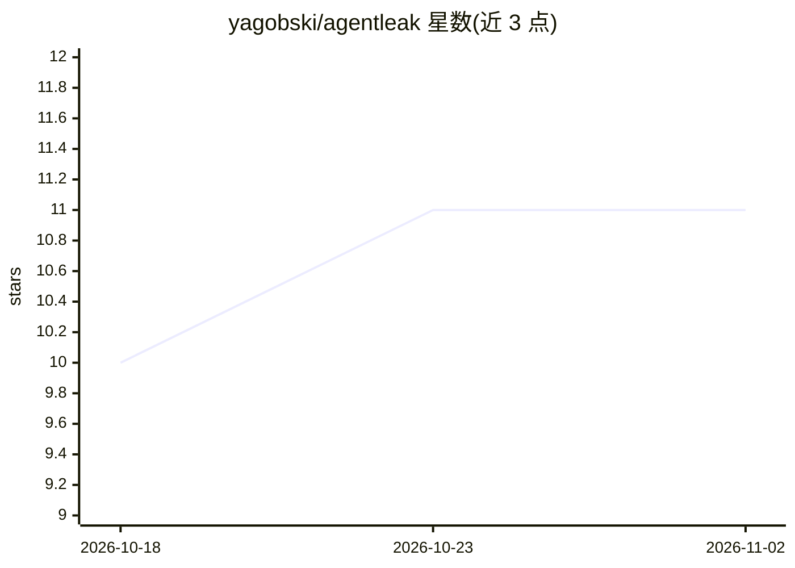

# yagobski/agentleak

⭐ 11 · Python · MIT · 推送 2026-10-30 · [GitHub](https://github.com/yagobski/agentleak) · [官网](https://www.agentleak.org) · 个人维护

**AI agent 隐私泄露检测工具：审计工具调用、内存与日志等通道**

面向 AI agent 的隐私泄露测试套件：输入执行 trace，检测 user_input、tool_call、shared_memory、inter_agent_message、log 等 8 个通道中的 PII、密钥、健康、财务等泄露，按 GDPR Art. 9 / Law 25 四级严重度加权、密度归一化计算 Risk Index。默认路径完全本地运行，无 LLM 依赖、无遥测，报告默认脱敏。以 Python SDK、CLI、本地 Web 平台与 MCP 工具形式提供，可接入 LangChain、CrewAI、AutoGen 等框架，支持在 CI 中以确定性断言做门禁。

## 筛选速览

| 维度 | 判定 | 备注 |
|---|---|---|
| AI 角色 | `ai-ecosystem` | LLM/agent 周边工具 |
| 许可风险 | `permissive` | MIT |
| 部署形态 | `library` | 以包/库形式分发 |
| 模型依赖 | — | README 未给出锁定关系 |
| 硬件要求 | — | 无带数字的原话,不猜 |
| 安装摩擦 | `low` | 无编译、无系统依赖或容器化 |
| 成熟度 | — | 结构信号不足 |

## 能力要点

- 8 个通道 × 9 个检测器（6 个正则/词典常开 + Presidio/LLM-judge 可选）
- AgentRisk 严重度加权密度归一化 Risk Index，满足 5 项形式化性质并在 CI 中校验
- 检测 base64/hex/URL 编码及反转、ROT13、拆分等混淆泄露副本
- 映射 14 个合规框架（GDPR、EU AI Act、HIPAA 等）的控制项

## 适用场景

- 上线前审计多 agent 系统在工具调用与共享内存中的敏感数据泄露
- 在 CI 中用确定性隐私策略断言做发布门禁
- 追踪泄露路径定位多 agent 系统中泄露源头
- 生成映射到 GDPR/EU AI Act 等框架控制项的审计报告

## 场景标签

`网络安全` · 领域:学习与行业

## 证据(README 行号)

> L23: Your agent's *final answer* can look perfectly clean while sensitive data leaks
> L35: A trace goes in, a privacy report comes out. Leakage is scored with

## 星数曲线

2026-10-18 10 → 2026-11-02 11（+1）

---
*卡片 v1 · prompt 1.4 · 生成 2026-11-01 · 置信度 high · 依据 README sha `537030286de2` · [字段定义](../../DATASET.md)*
