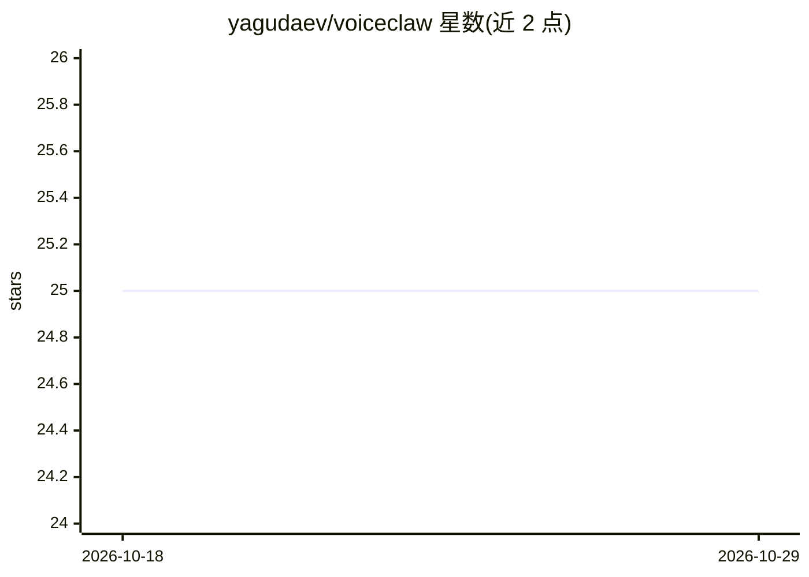

# yagudaev/voiceclaw

⭐ 25 · TypeScript · MIT · 推送 2026-09-07 · [GitHub](https://github.com/yagudaev/voiceclaw) · [官网](https://getvoiceclaw.com) · 个人维护

**给已有 AI agent 加实时语音的客户端：手机/桌面对话**

开源语音层应用：包含 React Native (Expo) iOS 应用、Electron macOS 桌面端和 TypeScript WebSocket 中继服务器。实时语音模型（Gemini Live / Grok Voice / OpenAI Realtime）负责对话，需调用工具、记忆或外部 API 时通过 ask_brain 模式转交给任意 OpenAI 兼容的既有 agent 端点（如 OpenClaw、Hermes、MCP agent），结果回流后语音模型继续作答。不内置 agent，需自备 brain 端点与至少一个 provider API key，从源码克隆并用 yarn 启动。

## 筛选速览

| 维度 | 判定 | 备注 |
|---|---|---|
| AI 角色 | `ai-ecosystem` | LLM/agent 周边工具 |
| 许可风险 | `permissive` | MIT |
| 部署形态 | `None` |  |
| 模型依赖 | locked-api |  |
| 硬件要求 | — | 无带数字的原话,不猜 |
| 安装摩擦 | `low` | 无编译、无系统依赖或容器化 |
| 成熟度 | — | 结构信号不足 |

## 能力要点

- ask_brain 升级模式：语音模型可调用任意 OpenAI 兼容 agent 的工具与记忆
- 三端结构：iOS 应用 + Electron macOS 桌面端（含屏幕共享）+ WebSocket 中继服务器
- 支持 Gemini Live、Grok Voice、OpenAI Realtime 三种实时语音 provider
- 支持 Langfuse tracing 集成

## 适用场景

- 让我用自己的 agent 通过手机或桌面进行实时语音对话
- 在 macOS 上边共享屏幕边与语音 agent 协作
- 为已部署的 MCP/OpenAI 兼容 agent 快速添加语音入口

## 场景标签

`语音 Agent` · 领域:对话与助手

## 证据(README 行号)

> L14: VoiceClaw is a **thin voice layer on top of your existing AI agent**. Already have an agent that can search the web
> L79: 3. The relay server routes `ask_brain` to **your existing agent** -- any OpenAI-compatible chat completions endpoin

## 星数曲线

2026-10-18 25 → 2026-10-29 25（+0）

---
*卡片 v1 · prompt 1.4 · 生成 2026-10-26 · 置信度 high · 依据 README sha `ded2e37e48e5` · [字段定义](../../DATASET.md)*
