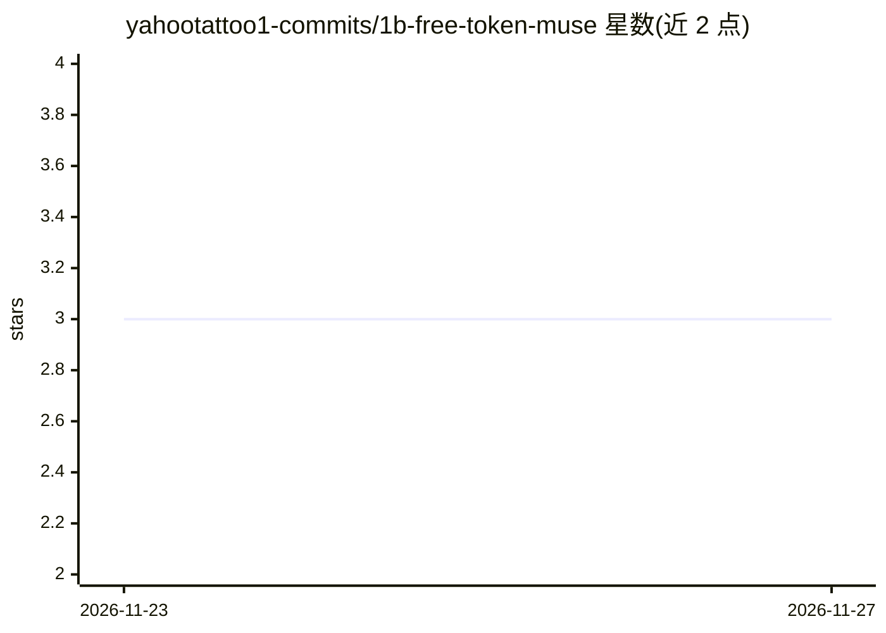

# yahootattoo1-commits/1b-free-token-muse

⭐ 3 · 推送 2026-11-24 · [GitHub](https://github.com/yahootattoo1-commits/1b-free-token-muse) · [官网](https://muse.ai/join) · 个人维护

**Muse AI 邀请码兑换教程：新用户领取 10 亿免费 tokens**

一份非官方的社区指南，介绍如何使用邀请码 8XBCL6 在 Muse（Meta 的个人 AI 助手）注册后 48 小时内兑换 10 亿 tokens 使用额度。内容覆盖注册步骤、兑换入口路径、限制条件（仅限新账户、每码约 20 次、地区可用性）与常见问题，以英文加波斯文双语呈现。仓库本身不包含代码，仅托管该指南与 muse.ai 的注册链接。

## 筛选速览

| 维度 | 判定 | 备注 |
|---|---|---|
| AI 角色 | `ai-knowledge` | 知识聚合/清单类 |
| 许可风险 | `none` | — |
| 部署形态 | `None` |  |
| 模型依赖 | — | README 未给出锁定关系 |
| 硬件要求 | — | 无带数字的原话,不猜 |
| 安装摩擦 | `low` | 无编译、无系统依赖或容器化 |
| 成熟度 | — | 结构信号不足 |

## 能力要点

- 提供邀请码 8XBCL6 的完整兑换流程（Settings → Redeem Code）
- 说明 48 小时兑换窗口与每码约 20 次使用上限等限制
- 英文与波斯文双语指南
- 声明为非官方社区指南，与 Meta/Muse 无隶属关系

## 适用场景

- 新注册 Muse 账户后按步骤兑换邀请码奖励
- 排查邀请码无法兑换的原因（窗口过期/码满/复制错误）
- 波斯语用户参考本地语言版兑换说明

## 场景标签

`教程课程` · 领域:学习与行业

## 证据(README 行号)

> L17: ## ✨ What is Muse?
> L52: ## 🚀 How to redeem in 2 minutes
> L118: *Disclaimer: This is an unofficial community guide, not affiliated with Meta or Muse. Rewards, limits, availabilit

## 星数曲线

2026-11-23 3 → 2026-11-27 3（+0）

---
*卡片 v1 · prompt 1.4 · 生成 2026-11-23 · 置信度 high · 依据 README sha `4db54b4dd6bb` · [字段定义](../../DATASET.md)*
