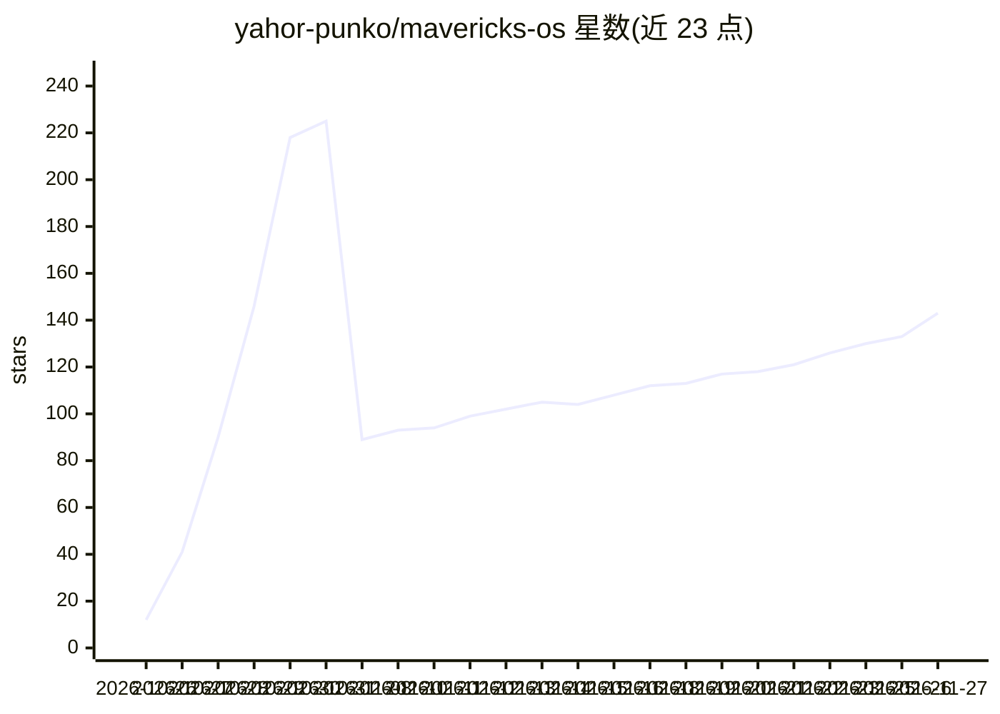

# yahor-punko/mavericks-os

⭐ 143 · JavaScript · NOASSERTION · 推送 2026-11-17 · [GitHub](https://github.com/yahor-punko/mavericks-os) · 个人维护

**为 Claude Code 子代理提供跨会话持久状态与任务编排**

面向 Claude Code 编码代理的编排框架：把项目状态写入版本化文件（BACKLOG.md、TASK_STATUS.md、PROCESS_STATE.json），通过专门化子代理角色（developer、QA、UX、security、architect 等）路由工作，用 pre-commit 校验器阻断状态不同步的提交（exit 2），并支持单/多仓库的 backlog 协调与 QA 门槛。默认以 bypassPermissions 自主执行工具，提供 SECURITY.md 说明与退出方式。安装依赖 Node.js 20+、Claude Code CLI 和 git。

## 筛选速览

| 维度 | 判定 | 备注 |
|---|---|---|
| AI 角色 | `ai-ecosystem` | LLM/agent 周边工具 |
| 许可风险 | `permissive` | NOASSERTION |
| 部署形态 | `None` |  |
| 模型依赖 | — | README 未给出锁定关系 |
| 硬件要求 | — | 无带数字的原话,不猜 |
| 安装摩擦 | `low` | 无编译、无系统依赖或容器化 |
| 成熟度 | — | 结构信号不足 |

## 能力要点

- 状态以版本化文件持久化，跨会话恢复而非从聊天记录重建
- pre-commit 校验器阻断 BACKLOG/TASK_STATUS 漂移
- spec 化子代理角色：developer、QA、UX、security、docs、architect
- 跨仓库 backlog 协调（附 N=1 案例研究数据）

## 适用场景

- 在多个仓库间用中央 backlog 协调代理开发任务
- 长周期项目跨会话保持任务与交接状态
- 提交前自动检测任务状态与实际改动不同步

## 场景标签

`多智能体` `编码 Agent` · 领域:Agent 开发

## 证据(README 行号)

> L3: # Mavericks OS for Claude Code
> L11: Mavericks persists project state across sessions, routes work through
> L82: |Role-specialised execution & review|❌|❌|⚠️ manual assignment|✅ spec'd sub-agent roles (developer, QA, UX, security

## 星数曲线

2026-10-26 12 → 2026-11-27 143（+131）

---
*卡片 v1 · prompt 1.4 · 生成 2026-11-27 · 置信度 high · 依据 README sha `be27c55f7420` · [字段定义](../../DATASET.md)*
