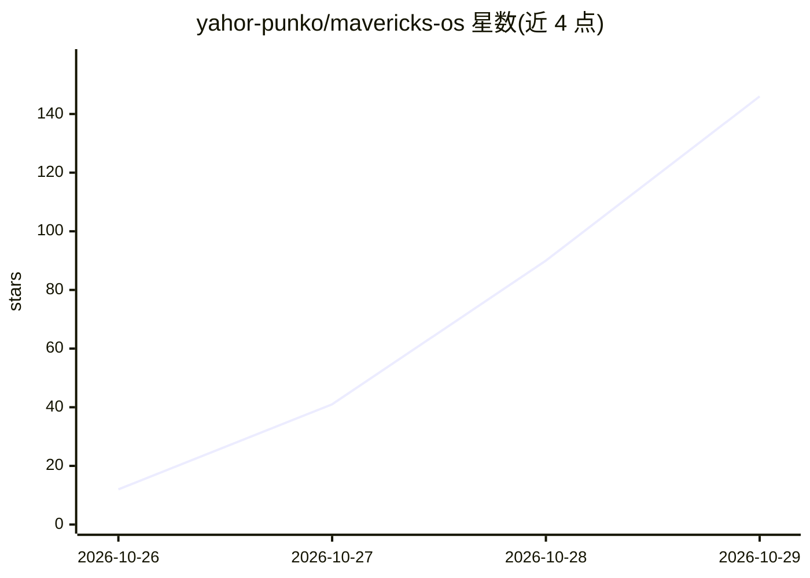

# yahor-punko/mavericks-os

⭐ 146 · JavaScript · NOASSERTION · 推送 2026-10-25 · [GitHub](https://github.com/yahor-punko/mavericks-os) · 个人维护

**为 Claude Code 编排子代理的会话状态与任务管理框架**

面向运营者和小团队的 Claude Code 代理编排框架：将项目状态持久化为版本化工件（BACKLOG.md、TASK_STATUS.md、PROCESS_STATE.json），跨会话恢复上下文；通过规格化子代理角色（developer、QA、UX、security 等）分工执行，用校验器在提交前拦截 backlog/task 状态漂移（exit 2），支持单一控制仓库协调多仓库任务。默认配置 bypassPermissions 自主执行工具，需在终端确认同意。安装需 Node.js 20+、Claude Code CLI 与 git，通过 install.sh 脚本或 git clone 部署，再经 mavp-install.js 引导到目标项目。README 附 N=1 无对照组的 Synth 生产案例观察数据。

## 筛选速览

| 维度 | 判定 | 备注 |
|---|---|---|
| AI 角色 | `ai-ecosystem` | LLM/agent 周边工具 |
| 许可风险 | `permissive` | NOASSERTION |
| 部署形态 | `None` |  |
| 模型依赖 | locked-api |  |
| 硬件要求 | — | 无带数字的原话,不猜 |
| 安装摩擦 | `low` | 无编译、无系统依赖或容器化 |
| 成熟度 | — | 结构信号不足 |

## 能力要点

- 版本化工件持久化会话状态，跨会话恢复而无需依赖聊天历史
- pre-commit 校验器拦截 BACKLOG/TASK_STATUS 不同步的提交（exit 2）
- 规格化子代理角色分工（developer、QA、UX、security、docs、architect 等）
- 单一控制仓库集中 backlog 协调多仓库任务

## 适用场景

- 跨天/跨会话的代理驱动开发，每次会话从书面状态恢复
- 多仓库项目中集中管理 backlog 与任务依赖
- 提交前自动检测任务状态漂移以保证可审计交付

## 场景标签

`多智能体` `Agent 框架` · 领域:Agent 开发

## 证据(README 行号)

> L11: Mavericks persists project state across sessions, routes work through
> L131: - Claude Code CLI (`claude`)
> L172: - `.claude/agents/*.md`, `.claude/skills/*/SKILL.md`, `.claude/rules/*.md` — sub-agent specs, skills, and rules, c

## 星数曲线

2026-10-26 12 → 2026-10-29 146（+134）

---
*卡片 v1 · prompt 1.4 · 生成 2026-10-27 · 置信度 high · 依据 README sha `cc5771517dc5` · [字段定义](../../DATASET.md)*
