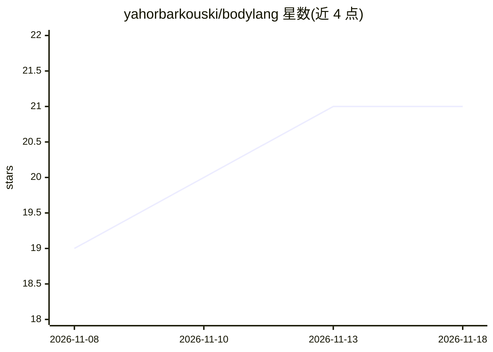

# yahorbarkouski/bodylang

⭐ 21 · TypeScript · MIT · 推送 2026-11-07 · [GitHub](https://github.com/yahorbarkouski/bodylang) · [官网](https://bodylang.vercel.app) · 个人维护

**本地运行的 3D 人体生理可视化应用：用 LLM 解读日常事件**

在本地 Node 环境运行的教育/健康可视化应用：用户用自然语言描述饮食、运动、疾病、睡眠等事件，LLM（经 API key 或 ChatGPT/Claude 订阅）将其转换为结构化记录并调用约二十个工具（如 log_food），内置逐分钟生理模型据此重算全天，结果呈现在 3D 人体、读数与日程图上；也可提问获得带镜头引导的可视化讲解。食物取自 12,750 条 USDA 表格，每个读数标注来源与证据等级；README 声明为早期 beta，所有数字均为估计，非医疗建议。

## 筛选速览

| 维度 | 判定 | 备注 |
|---|---|---|
| AI 角色 | `ai-native` | 本体是模型或模型工具 |
| 许可风险 | `permissive` | MIT |
| 部署形态 | `library` | 以包/库形式分发 |
| 模型依赖 | — | README 未给出锁定关系 |
| 硬件要求 | — | 无带数字的原话,不猜 |
| 安装摩擦 | `low` | 无编译、无系统依赖或容器化 |
| 成熟度 | `idea` | |

## 能力要点

- 自然语言事件记录 + 逐分钟生理模型 + 3D 人体可视化
- Ask 模式生成带相机移动与分步讲解的 walkthrough，支持 what-if 对照
- 读数标注来源（生理模型/LLM/USDA/用户）与 A/B/C 证据等级
- 模板化扩展：新增器官、过程、事件均为短文件
- 生理模型输出经与已发表数据校准的测试约束

## 适用场景

- 记录一天中吃喝与活动，看身体内部如何随时间变化
- 好奇提问（如咖啡因、捐血、月经）获得可视化机制讲解
- 导入血检数据、自定义身体属性做个人化模拟
- 按 what-if 对比不同选择（如少喝一杯咖啡）对当天的影响

## 场景标签

`数据分析` · 领域:效率与自动化

## 证据(README 行号)

> L3: Bodylang is a 3D human body that shows what's going on inside you. Tell it anything that's happened to you (a workou
> L23: The LLM turns your words into quantities and logs them, taking foods from a table of 12,750 USDA foods. The physiol
> L129: You type what happened, in your own words. The LLM works out what that means, such as which food, how much and whe

## 星数曲线

2026-11-08 19 → 2026-11-18 21（+2）

---
*卡片 v1 · prompt 1.4 · 生成 2026-11-18 · 置信度 high · 依据 README sha `c6f3d9982999` · [字段定义](../../DATASET.md)*
