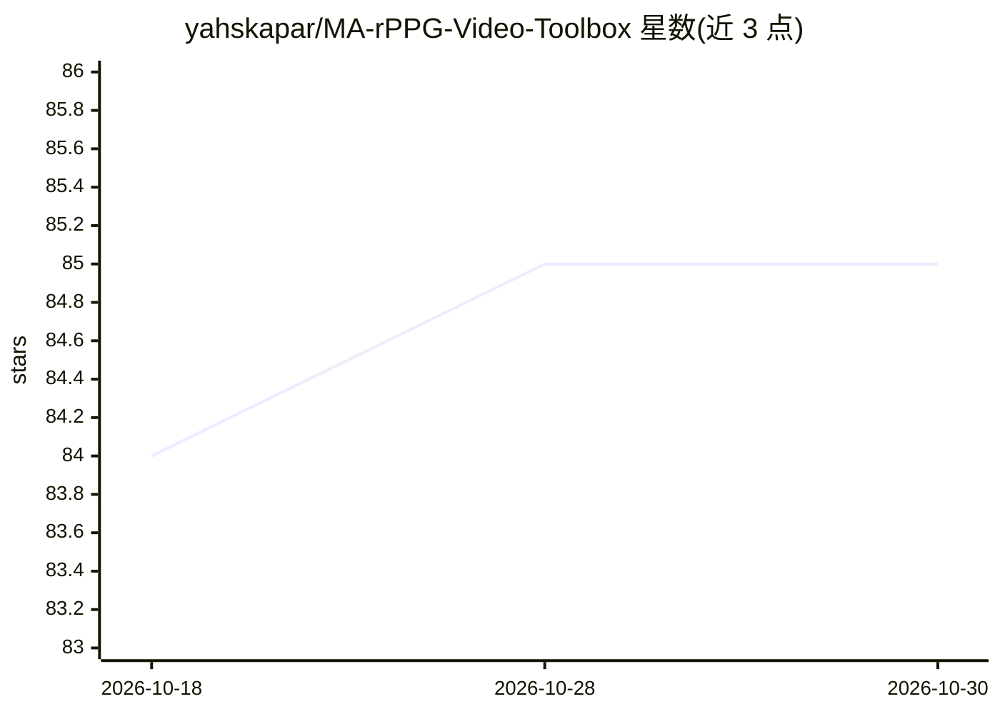

# yahskapar/MA-rPPG-Video-Toolbox

⭐ 85 · Python · NOASSERTION · 推送 2025-12-29 · [GitHub](https://github.com/yahskapar/MA-rPPG-Video-Toolbox) · [官网](https://motion-matters.github.io/) · 组织维护 · 中文 README

**rPPG 研究用的神经运动迁移数据增强视频工具箱**

WACV 2024 论文 Motion Matters 的源码与预训练模型仓库：将运动迁移用作数据增强手段，从驾驶视频中迁移人体运动到 rPPG 视频数据集（UBFC-rPPG、PURE、SCAMPS），在保留生理信号的同时引入运动变化，用于提升摄像头生理测量模型的泛化。基于 NVIDIA One-Shot Free-View Neural Talking-Head Synthesis 的非官方 PyTorch 实现，通过 augment_videos.py 生成增强数据集，另提供用于 rPPG-Toolbox 的预训练模型。需 conda 环境、指定版本 PyTorch 与 GPU。

## 筛选速览

| 维度 | 判定 | 备注 |
|---|---|---|
| AI 角色 | `ai-native` | 本体是模型或模型工具 |
| 许可风险 | `none` | NOASSERTION |
| 部署形态 | `library` | 以包/库形式分发 |
| 模型依赖 | — | README 未给出锁定关系 |
| 硬件要求 | — | 无带数字的原话,不猜 |
| 安装摩擦 | `medium` | 含编译或系统依赖之一 |
| 成熟度 | — | 结构信号不足 |

## 能力要点

- 运动迁移增强 UBFC-rPPG / PURE / SCAMPS 三个 rPPG 数据集
- 提供 Vox-256-Beta / Vox-256-New 等预训练模型下载
- 支持多进程与多 GPU（CUDA_VISIBLE_DEVICES）加速数据集生成
- 附带可在 rPPG-Toolbox 中使用的预训练模型

## 适用场景

- 为 rPPG 模型训练生成运动增强的视频数据集
- 复现论文中的跨数据集实验
- 研究运动幅度与类型对生理测量的影响

## 场景标签

`图像视频处理` `视频生成` · 领域:内容生成

## 证据(README 行号)

> L15: Machine learning models for camera-based physiological measurement can have weak generalization due to a lack of re
> L36: This motion-augmentation pipeline supports three rPPG video datasets - UBFC-rPPG, PURE, and SCAMPS. The pipeline ut

## 星数曲线

2026-10-18 84 → 2026-10-30 85（+1）

---
*卡片 v1 · prompt 1.4 · 生成 2026-10-24 · 置信度 high · 依据 README sha `cdc70a576f81` · [字段定义](../../DATASET.md)*
