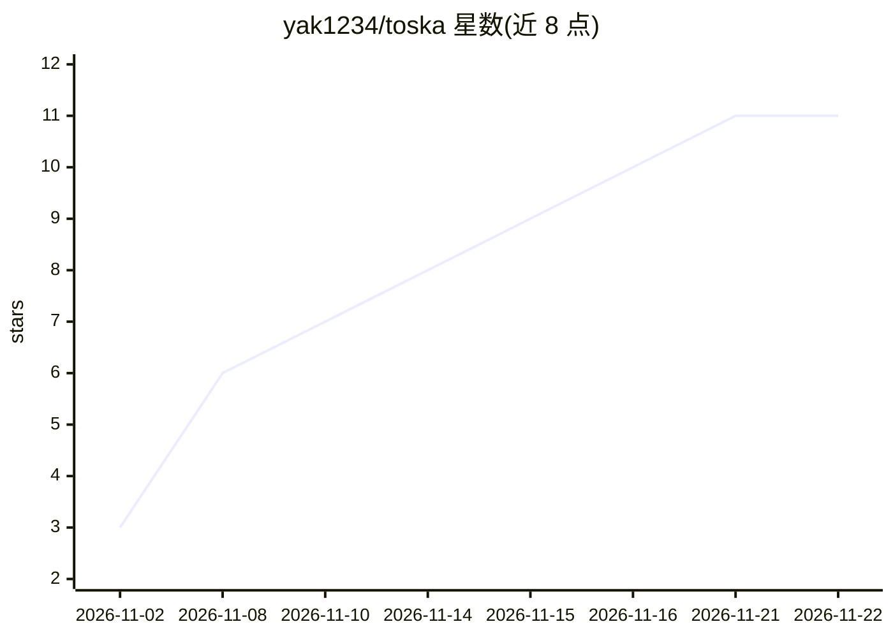

# yak1234/toska

⭐ 11 · C++ · GPL-3.0 · 推送 2026-11-16 · [GitHub](https://github.com/yak1234/toska) · 个人维护

**给画师的内置 AI Agent 绘画工具（Krita 分支）**

基于 Krita master（Qt 6）的独立分支，把一个 AI 画手嵌入面板对话中：Agent 每次画一笔实质性的笔触（可整层撤销），用户逐条保留或纠错；规划器读参考图拆分步骤，画手与准备工人并行推进，审阅者在独立会话中对照计划评判结果，另有快速视觉模型即时检查每轮笔触。支持命名区域限位绘制、参考图任务标注、可选的 AI 生成素材。另提供 MCP 服务器供编码 agent 驱动。当前为 pre-alpha，仅支持 Apple silicon macOS，需 API key。

## 筛选速览

| 维度 | 判定 | 备注 |
|---|---|---|
| AI 角色 | `ai-native` | 本体是模型或模型工具 |
| 许可风险 | `viral` | GPL-3.0 |
| 部署形态 | `None` |  |
| 模型依赖 | — | README 未给出锁定关系 |
| 硬件要求 | — | 无带数字的原话,不猜 |
| 安装摩擦 | `low` | 无编译、无系统依赖或容器化 |
| 成熟度 | `idea` | |

## 能力要点

- Ask/Plan/Agent/Autopilot 四档交互，每步可整体撤销
- 带任务标注的参考图系统（构图/配色/人物相似度等）
- 审阅者+快速视觉模型双重自检，可撤销变差的笔触
- MCP 服务器让 Claude Code 等编码 agent 以同样方式驱动

## 适用场景

- 在 Krita 流程中让 AI 分步画到指定区域
- 用参考图约束人物相似度与配色逐步成画
- 让编码 agent 通过 MCP 驱动画布操作

## 场景标签

`图像生成` · 领域:内容生成

## 证据(README 行号)

> L5: **Agentic painting inside Krita.** Toska is a fork of Krita (master, Qt 6) with an AI painter built in.
> L26: - **It checks its own work.** A vision model looks at each pass as it lands and undoes one that made the painting w

## 星数曲线

2026-11-02 3 → 2026-11-22 11（+8）

---
*卡片 v1 · prompt 1.4 · 生成 2026-11-19 · 置信度 high · 依据 README sha `7467297e804f` · [字段定义](../../DATASET.md)*
