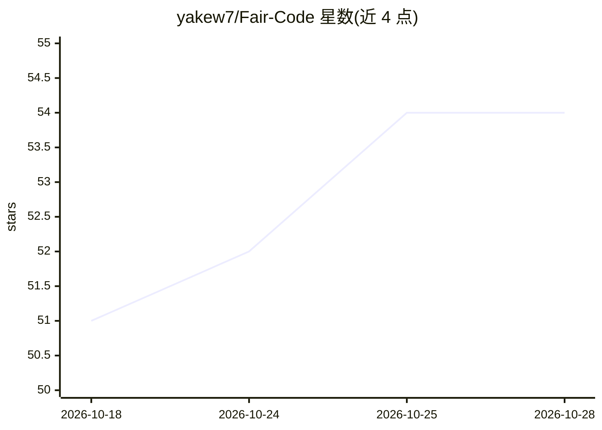

# yakew7/Fair-Code

⭐ 54 · HTML · MIT · 推送 2026-10-27 · [GitHub](https://github.com/yakew7/Fair-Code) · [官网](https://thefaircode.xyz) · 个人维护

**7 个领域 AI 偏见审计项目：量化公平性差距并给出修复**

研究与工程结合的算法偏见审计项目，覆盖刑事司法、招聘、信贷、医疗保险拒赔、福利资格、再入院与租户筛查 7 个场景。每个审计遵循统一流程：训练有偏模型、测量公平性差距、移除受保护属性及其代理变量后重训、再次测量，并附 unfair.py/fair.py 脚本与逐步讲解的 Jupyter notebook。项目对医疗 AI 偏见有专门聚焦，另发布 8 篇医疗 AI 解释性文章。面向关注负责任 AI 的开发者、研究者与从业者。

## 筛选速览

| 维度 | 判定 | 备注 |
|---|---|---|
| AI 角色 | `ai-native` | 本体是模型或模型工具 |
| 许可风险 | `permissive` | MIT |
| 部署形态 | `library` | 以包/库形式分发 |
| 模型依赖 | — | README 未给出锁定关系 |
| 硬件要求 | — | 无带数字的原话,不猜 |
| 安装摩擦 | `low` | 无编译、无系统依赖或容器化 |
| 成熟度 | — | 结构信号不足 |

## 能力要点

- 统一审计流水线：训练有偏模型→测量差距→修复→复测
- 7 个领域审计，量化报告公平性差距降幅（如 COMPAS 差距 86.77%→15.69%）
- 代理变量识别与移除（如 custody status 携带种族信号）
- 每个审计提供 Python 脚本与带可视化/注释的 Jupyter notebook

## 适用场景

- 学习如何在真实数据集上量化模型偏见并修复
- 在招聘、信贷、医疗等高风险场景开展公平性审计
- 理解代理变量如何绕过受保护属性引入歧视

## 场景标签

`模型评测` `教程课程` · 领域:评测与运维

## 证据(README 行号)

> L27: Fair Code is an ongoing research and engineering project that exposes bias in real-world AI systems and demonstrate
> L29: Every audit follows the same pipeline:
> L37: Each audit ships as both a pair of Python scripts (`unfair.py` / `fair.py`) for direct execution and a Jupyter note

## 星数曲线

2026-10-18 51 → 2026-10-28 54（+3）

---
*卡片 v1 · prompt 1.4 · 生成 2026-10-24 · 置信度 low · 依据 README sha `c067bb0e9a06` · [字段定义](../../DATASET.md)*
