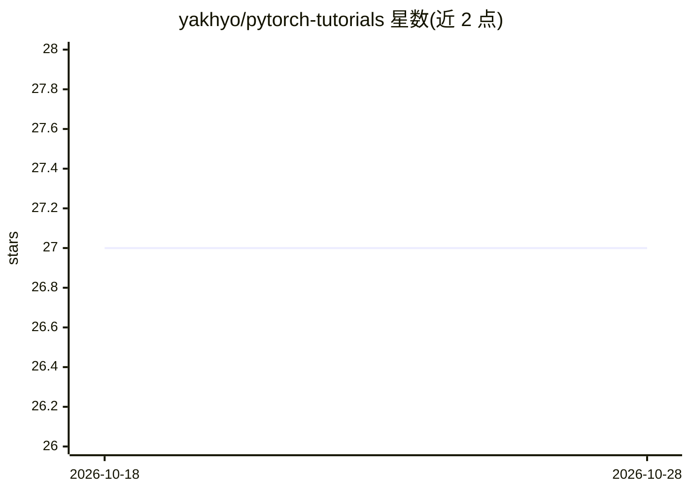

# yakhyo/pytorch-tutorials

⭐ 27 · Jupyter Notebook · MIT · 推送 2025-11-06 · [GitHub](https://github.com/yakhyo/pytorch-tutorials) · [官网](https://yakhyo.github.io/pytorch-tutorials/) · 个人维护

**PyTorch 教程集：覆盖基础到高级深度学习概念**

一组用 PyTorch 实现的深度学习教程，按难度分为 Basics、Beginner、Intermediate、Advanced 四级：涵盖张量操作、数据集与 DataLoader、变换增强、从零构建神经网络、优化器与模型保存加载、CNN/ResNet/RNN/LSTM 分类、VAE 重构、DCGAN、快速风格迁移，以及用 ONNX Runtime 运行超分辨率推理。每个主题提供脚本文件与 Notebook 两种形式，面向学习 PyTorch 与深度学习的开发者和学生，内容标注为持续更新中。

## 筛选速览

| 维度 | 判定 | 备注 |
|---|---|---|
| AI 角色 | `ai-knowledge` | 知识聚合/清单类 |
| 许可风险 | `permissive` | MIT |
| 部署形态 | `None` |  |
| 模型依赖 | — | README 未给出锁定关系 |
| 硬件要求 | — | 无带数字的原话,不猜 |
| 安装摩擦 | `low` | 无编译、无系统依赖或容器化 |
| 成熟度 | — | 结构信号不足 |

## 能力要点

- Basics 到 Advanced 四级难度组织的教程目录
- 每个主题提供 File 与 Notebook 两种形式
- 覆盖 CNN/ResNet/LSTM/VAE/DCGAN/风格迁移/超分辨率等实现
- 包含用 ONNX Runtime 做超分辨率推理的示例

## 适用场景

- 按难度递进学习 PyTorch 基础与神经网络构建
- 参考 CNN、LSTM、GAN 等经典模型的实现代码
- 了解模型保存加载与 ONNX Runtime 推理流程

## 场景标签

`教程课程` · 领域:学习与行业

## 证据(README 行号)

> L3: ## Contents
> L7: - **QuickStart** [File | Notebook] - **QuickStart** gives general overview of **Basics** section.
> L29: - Adversarial Generative Network - Deep Convolutional **Generative Adversarial Network**.

## 星数曲线

2026-10-18 27 → 2026-10-28 27（+0）

---
*卡片 v1 · prompt 1.4 · 生成 2026-10-26 · 置信度 high · 依据 README sha `6ce49b9d45db` · [字段定义](../../DATASET.md)*
