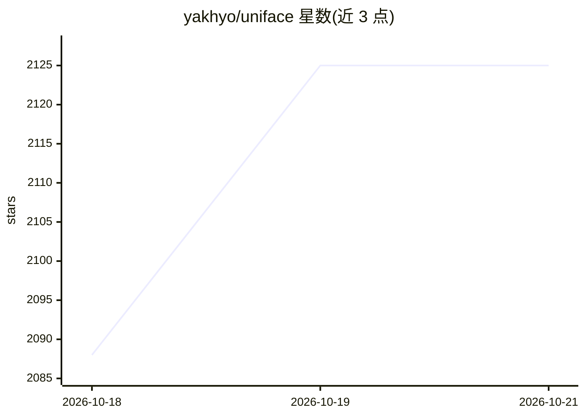

# yakhyo/uniface

⭐ 2,125 · Python · MIT · 推送 2026-10-17 · [GitHub](https://github.com/yakhyo/uniface) · [官网](https://yakhyo.github.io/uniface/) · 个人维护

**Python 人脸分析统一库：检测/识别/关键点/属性等 15 类任务**

面向计算机视觉开发者的 Python 人脸分析库，在统一 API 下覆盖检测、识别、跟踪、关键点、面部网格、解析、抠图、视线估计、头姿、人口属性、情绪、人脸状态、质量评估、反欺骗与匿名化共 15 类任务，各任务对应多种预训练模型（RetinaFace、AdaFace、BiSeNet、MODNet 等），并提供 FAISS 向量检索嵌入。FaceAnalyzer 单次调用完成检测-对齐-识别，属性模型按需启用。支持 CPU、Apple Silicon 与 CUDA，权重首次使用时下载并经 SHA-256 校验。库为 MIT 许可，部分预训练权重许可不同，商用需自查。需注意与 Rocket Software 的 Uniface 无关联。

## 筛选速览

| 维度 | 判定 | 备注 |
|---|---|---|
| AI 角色 | `ai-native` | 本体是模型或模型工具 |
| 许可风险 | `permissive` | MIT |
| 部署形态 | `library` | 以包/库形式分发 |
| 模型依赖 | — | README 未给出锁定关系 |
| 硬件要求 | `cpu-ok` | |
| 安装摩擦 | `medium` | 含编译或系统依赖之一 |
| 成熟度 | — | 结构信号不足 |

## 能力要点

- 统一 API 覆盖 15 类人脸任务，各任务多模型可选
- FaceAnalyzer 一次调用完成检测、对齐与识别
- 支持 CPU、Apple Silicon 与 CUDA，权重下载经 SHA-256 校验
- 内置 FAISS 向量检索支持的嵌入搜索

## 适用场景

- 在应用中做人脸检测、识别与嵌入检索
- 视频流中跟踪人脸并提取关键点、头姿与视线
- 做人脸属性分析、质量评估或活体反欺骗
- 对人脸图像做模糊匿名化处理

## 场景标签

`人脸识别` `图像视频处理` · 领域:感知与多模态

## 证据(README 行号)

> L15:  UniFace is a lightweight, production-ready Python library for face detection, recognition,
> L48: |Task|Models|

## 星数曲线

2026-10-18 2,088 → 2026-10-21 2,125（+37）

---
*卡片 v1 · prompt 1.4 · 生成 2026-10-21 · 置信度 high · 依据 README sha `2666669efb30` · [字段定义](../../DATASET.md)*
