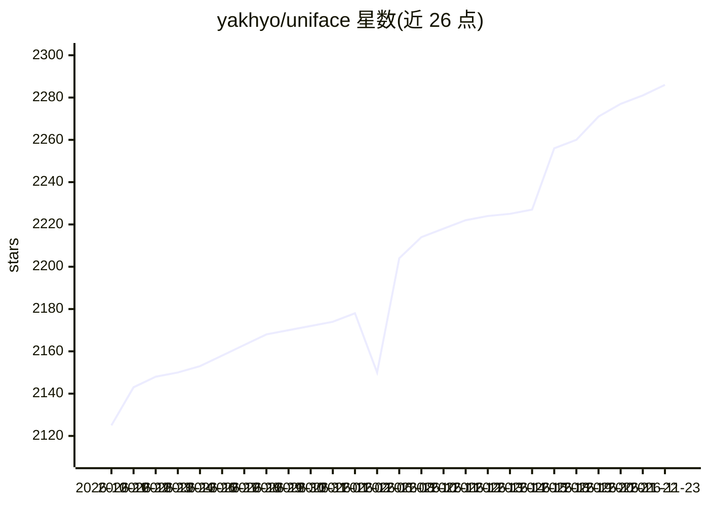

# yakhyo/uniface

⭐ 2,286 · Python · MIT · 推送 2026-11-21 · [GitHub](https://github.com/yakhyo/uniface) · [官网](https://yakhyo.github.io/uniface/) · 个人维护 · 中文 README

**Python 人脸分析库：检测/识别/属性等 15 类任务**

统一的 Python 人脸分析库，覆盖 15 类任务：检测、识别、跟踪、关键点、face mesh、解析、抠图、视线估计、头部姿态、人口属性、情绪、面部状态、质量评估、活体检测与匿名化。核心入口 FaceAnalyzer 一次调用完成检测、对齐与识别，属性模型按需启用。提供 Model Zoo 列出各任务对应模型（RetinaFace、AdaFace 等），权重首次使用时下载，支持 CPU、Apple Silicon 与 CUDA，附 Notebooks 与文档站。

## 筛选速览

| 维度 | 判定 | 备注 |
|---|---|---|
| AI 角色 | `ai-native` | 本体是模型或模型工具 |
| 许可风险 | `permissive` | MIT |
| 部署形态 | `library` | 以包/库形式分发 |
| 模型依赖 | — | README 未给出锁定关系 |
| 硬件要求 | `cpu-ok` | |
| 安装摩擦 | `medium` | 含编译或系统依赖之一 |
| 成熟度 | — | 结构信号不足 |

## 能力要点

- 15 类人脸分析任务单一库覆盖，Model Zoo 列明各任务模型
- FaceAnalyzer 一次调用完成检测、对齐与识别
- CPU / Apple Silicon / CUDA 均可运行，权重首次使用时下载
- FAISS 向量存储支持嵌入检索

## 适用场景

- 在视频上做人脸检测、跟踪与识别
- 从人脸读取年龄、性别、情绪、眼镜口罩等状态
- 活体检测区分真人影像与重放攻击
- 对图像中人脸做模糊匿名化处理

## 场景标签

`人脸识别` `图像视频处理` · 领域:感知与多模态

## 证据(README 行号)

> L15:  UniFace is a lightweight, production-ready Python library for face detection, recognition,
> L53: |Task|Models|
> L71: Runs on CPU, Apple Silicon and CUDA. Weights download on first use.

## 星数曲线

2026-10-21 2,125 → 2026-11-23 2,286（+161）

---
*卡片 v1 · prompt 1.4 · 生成 2026-11-23 · 置信度 high · 依据 README sha `4ce031813b5e` · [字段定义](../../DATASET.md)*
