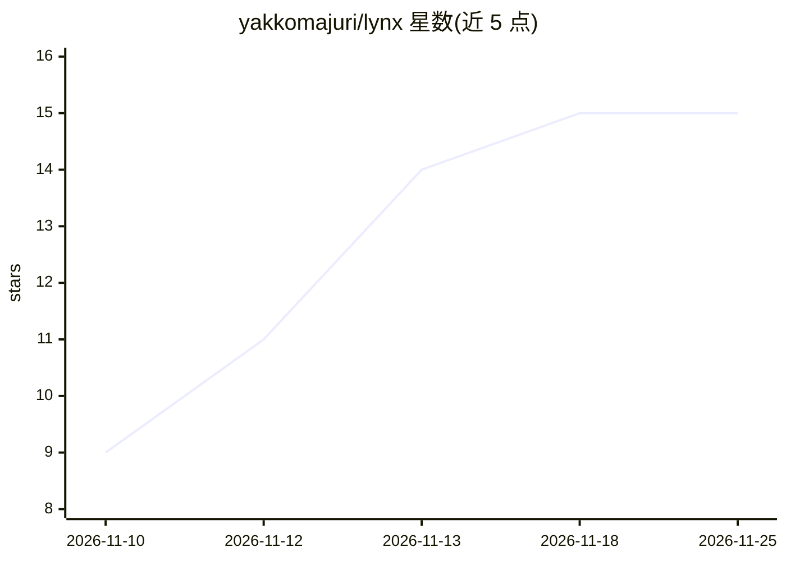

# yakkomajuri/lynx

⭐ 15 · TypeScript · MIT · 推送 2026-11-09 · [GitHub](https://github.com/yakkomajuri/lynx) · [官网](https://lynx.railcode.dev) · 个人维护

**完全本地运行、可自定义 UI 的开源 AI 工作区**

面向重度 AI 使用者的桌面工作区应用：以可自定义的交互式 UI（工作区）为中心组织与 agent 的交互，通过本机的 Claude Code 或 Codex 触发 agent，支持连接任意 MCP 或 API 服务、使用官方与社区模板、point-to-edit 编辑 UI、cron 定时调度任务。数据 100% 本地运行，使用用户自有的 Claude/Codex 订阅。作者自述仍属实验性质。提供 macOS 下载，MIT 许可。

## 筛选速览

| 维度 | 判定 | 备注 |
|---|---|---|
| AI 角色 | `ai-native` | 本体是模型或模型工具 |
| 许可风险 | `permissive` | MIT |
| 部署形态 | `None` |  |
| 模型依赖 | — | README 未给出锁定关系 |
| 硬件要求 | — | 无带数字的原话,不猜 |
| 安装摩擦 | `medium` | 含编译或系统依赖之一 |
| 成熟度 | `idea` | |

## 能力要点

- 100% 本地运行，数据不外发
- 通过本机 Claude Code / Codex 触发 agent，可随时切换
- 连接任意 MCP 或 API 服务
- cron 定时调度工具与 agent，point-to-edit 直接指示 UI 修改

## 适用场景

- 把 Jira 任务、文档编辑、编码、分析面板等整合进自定义工作区
- 用按钮或定时任务触发 agent，替代翻找多个对话线程
- 利用自己的 Claude Code/Codex 订阅构建个性化 agent 编排界面

## 场景标签

`编码 Agent` `AI 助手` · 领域:编码与开发

## 证据(README 行号)

> L13: Lynx solves this by putting interactive interfaces at the center of our interaction with agents. Workspaces in Lynx
> L18: - **Use your own subscriptions**: Lynx makes use of Claude Code and Codex running on your machine. Switch between t

## 星数曲线

2026-11-10 9 → 2026-11-25 15（+6）

---
*卡片 v1 · prompt 1.4 · 生成 2026-11-18 · 置信度 high · 依据 README sha `5e3bc7daeb2a` · [字段定义](../../DATASET.md)*
