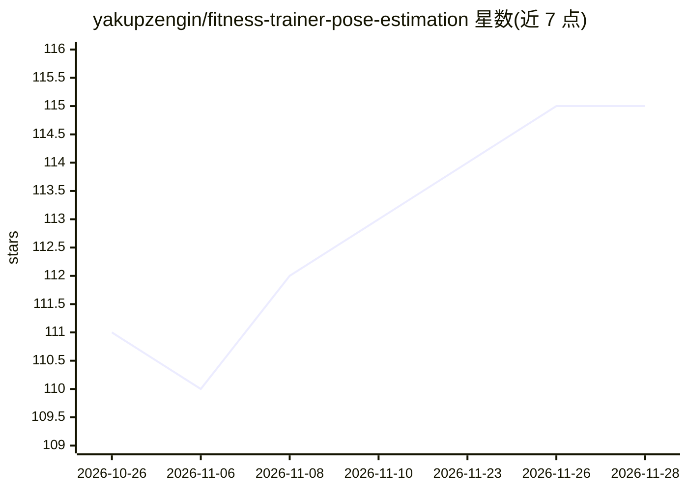

# yakupzengin/fitness-trainer-pose-estimation

⭐ 115 · Python · MIT · 推送 2026-11-25 · [GitHub](https://github.com/yakupzengin/fitness-trainer-pose-estimation) · 个人维护

**健身者的实时姿态估计锻炼计数与动作纠错 Web 应用**

基于 Flask 的 Web 应用：用 MediaPipe 姿态估计实时追踪 18 种内置动作（深蹲、俯卧撑、二头弯举等），以状态机逻辑自动计数，按角度准确度 40%、节奏 30%、警告 30% 加权计算 0-100 动作评分并给 A-F 等级与即时纠正提示。支持上传视频做骨架叠加分析并输出 H.264 视频；带用户档案、目标、成就与统计仪表盘。新动作通过 YAML 定义文件添加，无需写代码。需本地 Python 环境运行，浏览器访问使用。

## 筛选速览

| 维度 | 判定 | 备注 |
|---|---|---|
| AI 角色 | `ai-native` | 本体是模型或模型工具 |
| 许可风险 | `permissive` | MIT |
| 部署形态 | `None` |  |
| 模型依赖 | — | README 未给出锁定关系 |
| 硬件要求 | — | 无带数字的原话,不猜 |
| 安装摩擦 | `medium` | 含编译或系统依赖之一 |
| 成熟度 | — | 结构信号不足 |

## 能力要点

- 实时 MediaPipe 姿态估计，18 种内置动作覆盖全身
- 0-100 动作评分（角度40%/节奏30%/警告30%）与 A-F 等级
- 状态机逻辑自动计数与即时纠正反馈
- YAML 定义新动作，无需编码扩展

## 适用场景

- 居家训练时用摄像头自动计数深蹲/俯卧撑并获得姿势纠正
- 上传已录制的锻炼视频做骨架叠加回放分析
- 记录锻炼历史、目标与成就的仪表盘追踪

## 场景标签

`目标检测` · 领域:感知与多模态

## 证据(README 行号)

> L3: An AI-powered web application that tracks your exercises using computer vision and provides real-time form feedback 
> L13: - 📷 **Real-time Pose Estimation** using MediaPipe
> L194: - **MediaPipe** - Google's pose estimation model

## 星数曲线

2026-10-26 111 → 2026-11-28 115（+4）

---
*卡片 v1 · prompt 1.4 · 生成 2026-11-28 · 置信度 high · 依据 README sha `99f42c81b342` · [字段定义](../../DATASET.md)*
