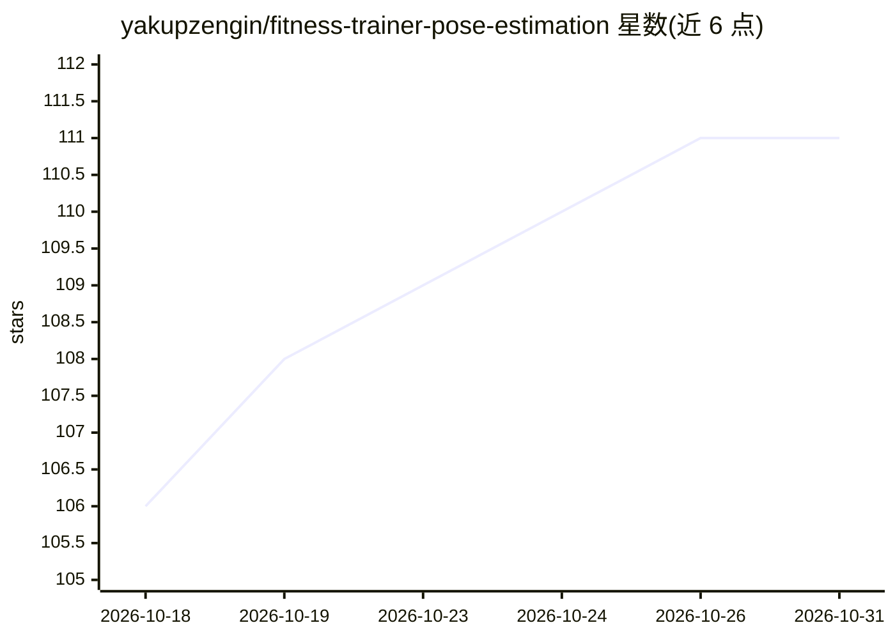

# yakupzengin/fitness-trainer-pose-estimation

⭐ 111 · Python · MIT · 推送 2026-02-19 · [GitHub](https://github.com/yakupzengin/fitness-trainer-pose-estimation) · 个人维护

**基于姿态估计的健身训练 Web 应用：计数、评分、实时纠正**

Flask + OpenCV + MediaPipe 实现的 Web 健身追踪应用：通过摄像头实时姿态估计，对 18 种内置动作（深蹲、俯卧撑、二头弯举等）自动计数、计算 0-100 分的动作评分（角度准确度 40%、节奏 30%、形态反馈 30%）并给出 A-F 等级与即时纠正提示；支持上传视频分析并叠加骨架输出 H.264 视频。提供用户资料、目标、成就与数据看板。新动作通过 YAML 定义即可扩展，无需写代码。以源码方式安装，运行 python app.py 后浏览器访问 127.0.0.1:5000。

## 筛选速览

| 维度 | 判定 | 备注 |
|---|---|---|
| AI 角色 | `ai-native` | 本体是模型或模型工具 |
| 许可风险 | `permissive` | MIT |
| 部署形态 | `None` |  |
| 模型依赖 | — | README 未给出锁定关系 |
| 硬件要求 | — | 无带数字的原话,不猜 |
| 安装摩擦 | `medium` | 含编译或系统依赖之一 |
| 成熟度 | — | 结构信号不足 |

## 能力要点

- MediaPipe 实时姿态估计与状态机自动计数
- 0-100 分动作评分体系（角度/节奏/反馈三项加权，A-F 等级）
- 18 种内置动作，YAML 定义新动作无需编码
- 视频上传分析：骨架叠加、处理日志、H.264 输出

## 适用场景

- 在家训练时用摄像头获得动作计数与实时纠正提示
- 上传预录训练视频，查看带骨架叠加的分析结果
- 追踪个人训练历史、目标与成就

## 场景标签

`图像视频处理` `目标检测` · 领域:感知与多模态

## 证据(README 行号)

> L3: An AI-powered web application that tracks your exercises using computer vision and provides real-time form feedback 
> L13: - 📷 **Real-time Pose Estimation** using MediaPipe

## 星数曲线

2026-10-18 106 → 2026-10-31 111（+5）

---
*卡片 v1 · prompt 1.4 · 生成 2026-10-23 · 置信度 high · 依据 README sha `c075fe697a36` · [字段定义](../../DATASET.md)*
