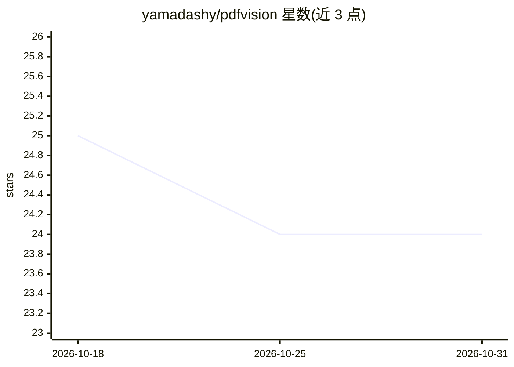

# yamadashy/pdfvision

⭐ 24 · TypeScript · MIT · 推送 2026-10-30 · [GitHub](https://github.com/yamadashy/pdfvision) · [官网](https://pdfvision.dev) · 个人维护

**面向 AI agent 的 PDF 提取工具：CLI/MCP/TS 库，暴露提取失败**

提供 CLI、MCP 服务器与 TypeScript 库三种形态，从 PDF 中提取文本、布局与页面图像供 AI agent 使用。核心机制是把提取的静默失败转为可恢复错误：每页输出文本覆盖率与质量信号，warning 指明具体风险（字形损坏、栅格文本、阅读顺序错乱等）并附下一步操作建议；支持搜索→缩放→渲染流程按需裁剪证据图像，多格式输出（markdown/json/xml/toon）。警告为保守启发式，非正确性证明。

## 筛选速览

| 维度 | 判定 | 备注 |
|---|---|---|
| AI 角色 | `ai-ecosystem` | LLM/agent 周边工具 |
| 许可风险 | `permissive` | MIT |
| 部署形态 | `library` | 以包/库形式分发 |
| 模型依赖 | — | README 未给出锁定关系 |
| 硬件要求 | — | 无带数字的原话,不猜 |
| 安装摩擦 | `low` | 无编译、无系统依赖或容器化 |
| 成熟度 | — | 结构信号不足 |

## 能力要点

- 每页文本覆盖率与质量信号，warning 附带下一步操作建议
- --search/--render-region 的搜索→裁剪→渲染按需取证据
- MCP 服务器暴露 read_pdf/search_pdf/render_pdf 三个工具，响应有预算控制
- markdown/json/xml/toon 四种输出格式

## 适用场景

- AI agent 读取 PDF 前先获知哪些页的文本不可信
- 通过 MCP 在无法运行 shell 的宿主（Claude Desktop/Cursor 等）中使用
- 长文档按页/按搜索命中渐进消费，控制上下文开销

## 场景标签

`文档解析` · 领域:知识与检索

## 证据(README 行号)

> L17: 🔍 **pdfvision** is a CLI, MCP server, and TypeScript library that extracts text, layout, and page images from PDFs 
> L94: For hosts that cannot run a shell — Claude Desktop, Cursor, Cline, Zed, n8n — pdfvision serves itself over MCP on s
> L108: |`read_pdf`|Text as Markdown. Without `pages` on a long document it returns a **document map** — page count, outli

## 星数曲线

2026-10-18 25 → 2026-10-31 24（-1）

---
*卡片 v1 · prompt 1.4 · 生成 2026-10-27 · 置信度 high · 依据 README sha `ca1dcf38696d` · [字段定义](../../DATASET.md)*
