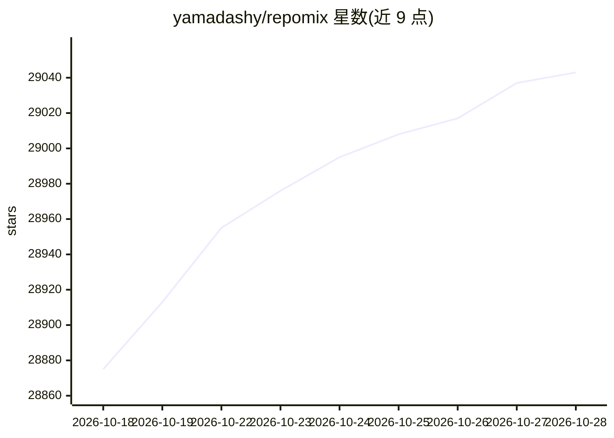

# yamadashy/repomix

⭐ 29,060 · TypeScript · MIT · 推送 2026-10-28 · [GitHub](https://github.com/yamadashy/repomix) · [官网](https://repomix.com) · 个人维护

**给开发者把整个仓库打包成单文件供 LLM 使用**

一个 CLI/网站/浏览器扩展工具，将仓库内容打包为单个 AI 友好格式文件。提供 XML/Markdown/JSON/纯文本四种输出格式，统计每文件与整仓 token 数，支持 .gitignore 感知、Secretlint 凭证检测排除、Tree-sitter 代码压缩，可打包远程仓库与 stdin 文件列表。通过 npm 安装或 Docker 运行，也可在 repomix.com 网页使用，另提供 Chrome/Firefox 扩展与社区 VSCode 扩展。生成文件可发送给各类 AI 工具做代码审查、文档生成、测试用例生成等。

## 筛选速览

| 维度 | 判定 | 备注 |
|---|---|---|
| AI 角色 | `ai-ecosystem` | LLM/agent 周边工具 |
| 许可风险 | `permissive` | MIT |
| 部署形态 | `self-host` | docker 或自建部署 |
| 模型依赖 | — | README 未给出锁定关系 |
| 硬件要求 | — | 无带数字的原话,不猜 |
| 安装摩擦 | `low` | 无编译、无系统依赖或容器化 |
| 成熟度 | — | 结构信号不足 |

## 动量与使用信号

- 维护:`active` — 距上次 push 1.3 天,年发版 20,78 位贡献者
- 涨星:近 1 天 **+17**(自 20261016 起算)
- 安装:npm 包 `repomix` 月下载 411,572
- 平台:WINDOWS / MACOS / LINUX · 协议:OPENAI-API / MCP

## 能力要点

- 单命令打包整仓并生成 repomix-output.xml 等格式文件
- token 计数与 Tree-sitter 代码压缩（--compress）
- Secretlint 凭证格式检测并从输出中排除
- 支持远程仓库打包、git log 注入与 stdin 文件列表

## 适用场景

- 把代码库喂给 AI 助手做代码审查与重构建议
- 基于仓库内容生成文档或测试用例
- 通过 JSON 输出配合 jq 做程序化文件分析

## 场景标签

`代码审查` · 领域:编码与开发

## 证据(README 行号)

> L46: 📦 Repomix is a powerful tool that packs your entire repository into a single, AI-friendly file.
> L71: - **AI-Optimized**: Formats your codebase in a way that's easy for AI to understand and process.
> L238: Once you have generated the packed file, you can use it with Generative AI tools like ChatGPT, DeepSeek, Perplexit

## 星数曲线

2026-10-18 28,875 → 2026-10-28 29,043（+168）

---
*卡片 v1 · prompt 1.4 · 生成 2026-10-18 · 置信度 high · 依据 README sha `6071af56fa23` · [字段定义](../../DATASET.md)*
