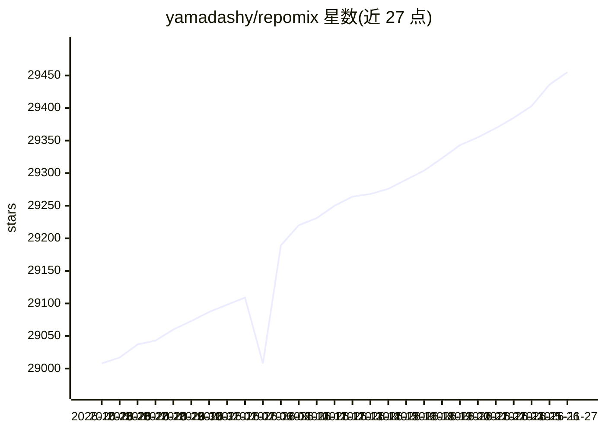

# yamadashy/repomix

⭐ 29,455 · TypeScript · MIT · 推送 2026-11-26 · [GitHub](https://github.com/yamadashy/repomix) · [官网](https://repomix.com) · 个人维护

**给开发者把代码仓库打包成单一 AI 友好文件的工具**

Repomix 以 CLI、网页、浏览器扩展和 VSCode 扩展四种形态提供，将整个仓库合并为单个文件供用户粘贴给 LLM 工具。机制上支持 .gitignore/.repomixignore 过滤、Secretlint 凭据检测排除、Tree-sitter 压缩提取关键代码元素、按文件与全库的 token 计数、可包含 git 日志；输出支持 XML/Markdown/JSON/纯文本四种格式，README 给出代码审查、文档生成、测试用例生成等示例 prompt。Python 用户被引导至 Gitingest。

## 筛选速览

| 维度 | 判定 | 备注 |
|---|---|---|
| AI 角色 | `ai-ecosystem` | LLM/agent 周边工具 |
| 许可风险 | `permissive` | MIT |
| 部署形态 | `self-host` | docker 或自建部署 |
| 模型依赖 | — | README 未给出锁定关系 |
| 硬件要求 | — | 无带数字的原话,不猜 |
| 安装摩擦 | `low` | 无编译、无系统依赖或容器化 |
| 成熟度 | — | 结构信号不足 |

## 动量与使用信号

- 维护:`active` — 距上次 push 1.3 天,年发版 20,78 位贡献者
- 涨星:近 1 天 **+17**(自 20261016 起算)
- 安装:npm 包 `repomix` 月下载 411,572
- 平台:WINDOWS / MACOS / LINUX · 协议:OPENAI-API / MCP

## 能力要点

- 一条命令将整个仓库打包为单一 AI 友好文件
- 输出支持 XML、Markdown、JSON、纯文本四种格式
- Tree-sitter 压缩选项提取关键代码元素以降低 token 数
- Secretlint 检测并排除匹配已知凭据格式的文件

## 适用场景

- 把代码库交给 LLM 做代码审查与重构建议
- 基于仓库内容生成 README 等项目文档
- 让 AI 分析整个代码库并生成测试用例
- 通过远程仓库地址直接打包 GitHub 项目

## 场景标签

`代码审查` `代码生成` · 领域:编码与开发

## 证据(README 行号)

> L46: 📦 Repomix is a powerful tool that packs your entire repository into a single, AI-friendly file.
> L71: - **AI-Optimized**: Formats your codebase in a way that's easy for AI to understand and process.
> L98: That's it! Repomix will generate a `repomix-output.xml` file in your current directory, containing your entire

## 星数曲线

2026-10-25 29,008 → 2026-11-27 29,455（+447）

---
*卡片 v1 · prompt 1.4 · 生成 2026-11-22 · 置信度 high · 依据 README sha `3b35d007f5db` · [字段定义](../../DATASET.md)*
