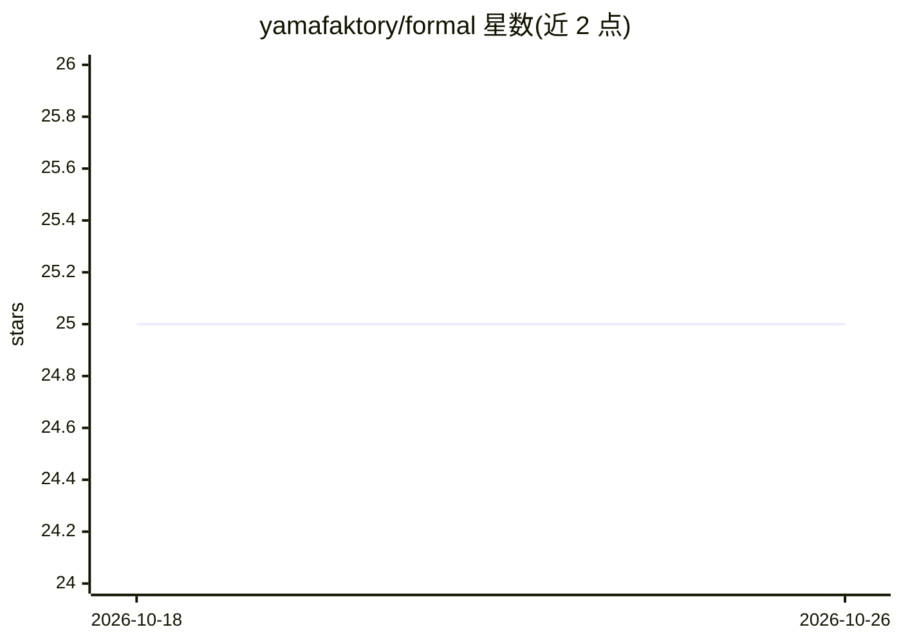

# yamafaktory/formal

⭐ 25 · Rust · MIT · 推送 2026-09-30 · [GitHub](https://github.com/yamafaktory/formal) · 个人维护

**基于 Lean 4 + Mathlib 的代码属性形式化验证服务，供 agent 调用**

面向编码 agent 的证明检查服务：agent 将代码中纯函数需满足的性质写成 Lean 4 定理并给证明，formal 在保持 Mathlib 加载的 Lean 进程中检查证明，返回 verified 或带提示的首个错误。检查失败前先尝试自动 tactic 链与 exact? 恢复；审计证明的公理依赖（拒绝 sorry、自声明公理、可运行代码）；缓存通过证明并检测代码变更导致属性过期。自身不调用模型、无需 API key，以本地服务器（HTTP 接口）+ CLI 提供，Linux/macOS 有预编译二进制，其他平台需 Rust 工具链源码构建；首次 setup 下载数 GB 的 Mathlib oleans。

## 筛选速览

| 维度 | 判定 | 备注 |
|---|---|---|
| AI 角色 | `ai-ecosystem` | LLM/agent 周边工具 |
| 许可风险 | `permissive` | MIT |
| 部署形态 | `library` | 以包/库形式分发 |
| 模型依赖 | — | README 未给出锁定关系 |
| 硬件要求 | — | 无带数字的原话,不猜 |
| 安装摩擦 | `low` | 无编译、无系统依赖或容器化 |
| 成熟度 | — | 结构信号不足 |

## 能力要点

- 常驻 Lean 进程保持 Mathlib 加载，检查耗时低并缓存已通过证明
- 证明失败前自动尝试 tactic 链与 Mathlib 前提搜索（exact?）恢复
- 审计公理依赖：拒绝 sorry、自声明公理、native_decide 与可运行代码
- 代码变更后属性标记为 stale 拒绝检查，覆盖任意语言（按规范化文本比较）

## 适用场景

- 让编码 agent 为生成的纯函数写 Lean 定理并自动验证逻辑性质
- 以提交到仓库的 spec 文件维护可评审、可复用的已验证性质记录
- 在 CI 流程中检出代码变更导致的过期属性

## 场景标签

 · 领域:软件工程/形式化验证工具

## 证据(README 行号)

> L5: **Property checker for code, backed by Lean 4 and Mathlib. Your agent writes the
> L13: formal does not call a model. It needs no API key and has no opinion about which model
> L168: For Claude Code, add this to `CLAUDE.md`. For other agents, use their equivalent file.

## 星数曲线

2026-10-18 25 → 2026-10-26 25（+0）

---
*卡片 v1 · prompt 1.4 · 生成 2026-10-26 · 置信度 high · 依据 README sha `e76acc11f7ba` · [字段定义](../../DATASET.md)*
