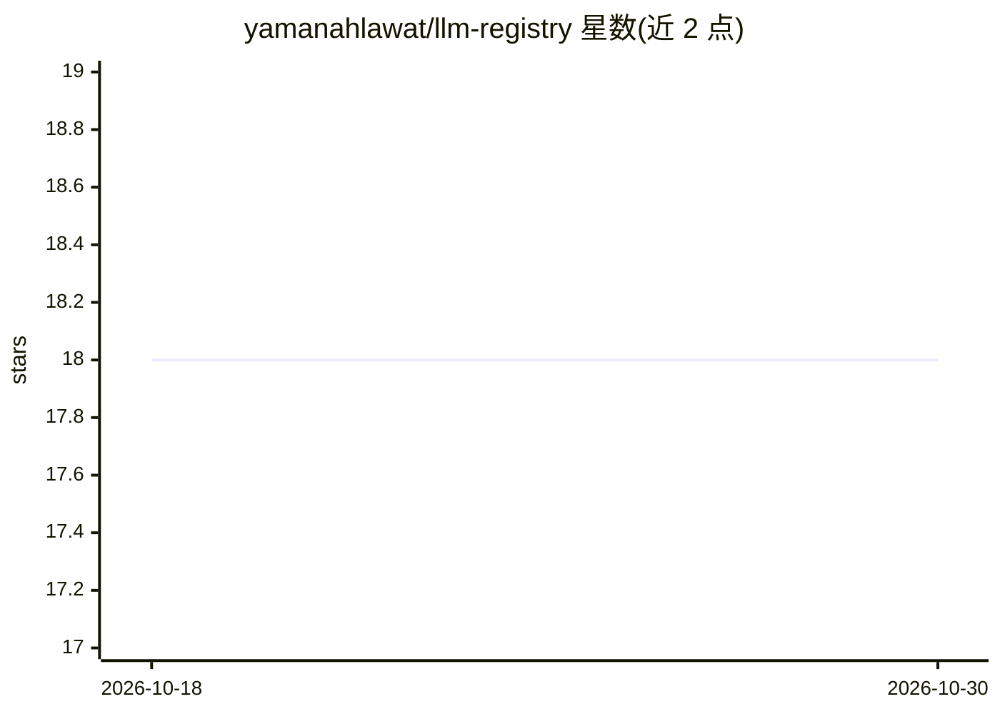

# yamanahlawat/llm-registry

⭐ 18 · Python · MIT · 推送 2026-06-09 · [GitHub](https://github.com/yamanahlawat/llm-registry) · 个人维护

**多厂商 LLM 模型能力与成本元数据注册查询库**

Python 包，集中管理多家 LLM 提供商（OpenAI、Anthropic、Google、Cohere、Mistral、Meta 等）的模型元数据：输入/输出 token 成本、缓存定价、上下文窗口、流式/视觉/工具调用/JSON 模式等特性与限制。内置含 100+ 模型的注册表，同时支持本地存储用户自定义模型配置（默认 ~/.llm-registry）。提供 Python API 与 CLI（llmr list/get/add），面向需要在调用 API 前核查模型能力与成本的开发者。要求 Python 3.11+，MIT 许可。

## 筛选速览

| 维度 | 判定 | 备注 |
|---|---|---|
| AI 角色 | `ai-ecosystem` | LLM/agent 周边工具 |
| 许可风险 | `permissive` | MIT |
| 部署形态 | `library` | 以包/库形式分发 |
| 模型依赖 | — | README 未给出锁定关系 |
| 硬件要求 | — | 无带数字的原话,不猜 |
| 安装摩擦 | `low` | 无编译、无系统依赖或容器化 |
| 成熟度 | — | 结构信号不足 |

## 能力要点

- 统一接口查询 OpenAI/Anthropic/Google/Cohere/Mistral/Meta 等厂商模型能力
- 追踪输入/输出/缓存 token 成本与上下文窗口限制
- 内置 100+ 模型注册表，支持本地自定义模型条目
- 提供 CLI（llmr）与 Python API 两种使用方式

## 适用场景

- 调用 API 前核查某模型是否支持流式、视觉、工具调用
- 跨厂商比较模型的 token 成本与上下文限制
- 维护私有/自定义模型配置并与内置注册表并用

## 场景标签

 · 领域:LLM 基础设施

## 证据(README 行号)

> L8: A Python package for managing LLM model capabilities across multiple providers. Track pricing, features, and limitat
> L12: Working with multiple LLM providers means juggling different pricing models, feature sets, and API parameters. LLM 

## 星数曲线

2026-10-18 18 → 2026-10-30 18（+0）

---
*卡片 v1 · prompt 1.4 · 生成 2026-10-29 · 置信度 high · 依据 README sha `d2862b0dbc55` · [字段定义](../../DATASET.md)*
