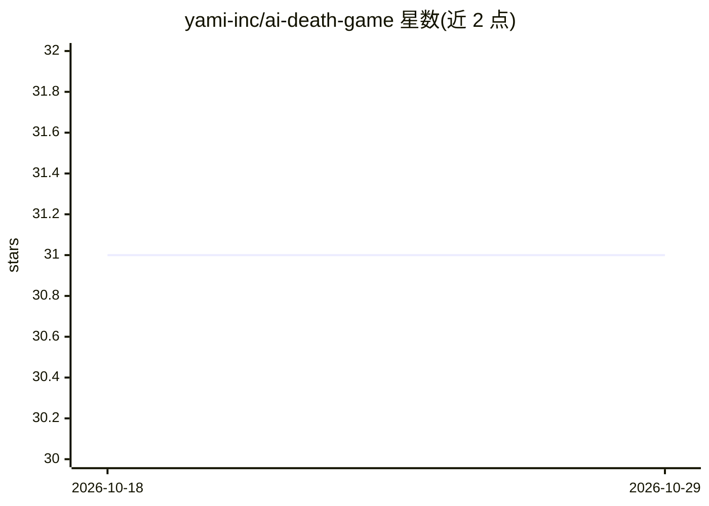

# yami-inc/ai-death-game

⭐ 31 · TypeScript · MIT · 推送 2026-10-23 · [GitHub](https://github.com/yami-inc/ai-death-game) · [官网](https://deathgame.ai.yami.net/) · 组织维护

**浏览器版 AI 死亡游戏：5 个 AI 代理辩论互投，玩家任 GM 介入**

基于 Next.js 16 / React 19 的浏览器游戏，由 Gemini API 驱动：从 14+隐藏角色池随机选出 5 个 AI 代理，进行两轮讨论后投票淘汰，直到剩 1 名生存者或全灭。玩家作为游戏主持人可中途注入文本指令、强制淘汰、追加票数。全部 API 调用在浏览器端完成，无需服务器，Gemini API key 存于 sessionStorage、免费额度即可游玩；含 44 项奖杯解锁隐藏角色。需 Node.js 20.19+/22.13+/24+，通过 git clone + npm 安装运行，支持 Vercel 部署。

## 筛选速览

| 维度 | 判定 | 备注 |
|---|---|---|
| AI 角色 | `ai-native` | 本体是模型或模型工具 |
| 许可风险 | `permissive` | MIT |
| 部署形态 | `self-host` | docker 或自建部署 |
| 模型依赖 | — | README 未给出锁定关系 |
| 硬件要求 | — | 无带数字的原话,不猜 |
| 安装摩擦 | `low` | 无编译、无系统依赖或容器化 |
| 成熟度 | — | 结构信号不足 |

## 能力要点

- 5 个 AI 代理讨论-投票-淘汰的循环机制，玩家以 GM 身份注入指令/强制淘汰/追加票数
- 无服务器架构：API key 仅存浏览器 sessionStorage，直接调用 Google API
- 主模型 gemini-3-flash-preview，失败时回退 gemini-2.5-flash
- 44+ 角色池与奖杯解锁隐藏角色系统

## 适用场景

- 观察多个 AI 代理辩论与相互淘汰的娱乐体验
- 以 GM 身份介入并操控 AI 讨论进程
- 自托管部署供他人游玩（Vercel/Cloud Run）

## 场景标签

`多智能体` · 领域:Agent 开发

## 证据(README 行号)

> L21: A browser-based death game simulator powered by Gemini. 5 AI agents with unique personalities debate and vote to el
> L23: **No server required.** Your Gemini API key stays in your browser and is sent directly to Google's API.

## 星数曲线

2026-10-18 31 → 2026-10-29 31（+0）

---
*卡片 v1 · prompt 1.4 · 生成 2026-10-26 · 置信度 mid · 依据 README sha `b65736683160` · [字段定义](../../DATASET.md)*
