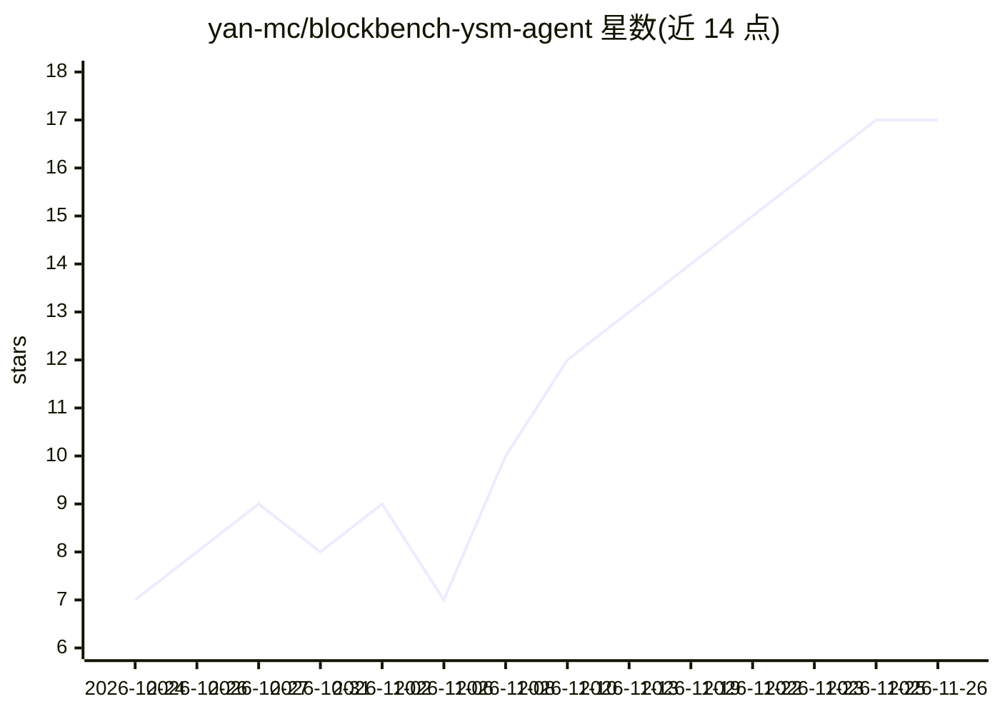

# yan-mc/blockbench-ysm-agent

⭐ 17 · Python · NOASSERTION · 推送 2026-11-08 · [GitHub](https://github.com/yan-mc/blockbench-ysm-agent) · [官网](https://github.com/yan-mc/blockbench-ysm-agent/releases) · 个人维护 · 中文 README

**给 dsh 里的 AI 接入 Blockbench：语义建模 YSM 模型与贴图**

面向 Minecraft YSM 皮肤/模型的 AI 建模工作台，由 dsh Host 插件（44 个 bb_* 语义工具、5 命令、1 个 Skill）与 Blockbench 插件通过 JSON-RPC/WebSocket 通信组成，隐藏运行真实 Blockbench 5.2.2。Agent 通过语义工具操作骨骼、方块、UV、贴图、动画，经无头离屏渲染回传 PNG 做视觉自检，支持检查点/回滚、参考图三级管线（T3 云端付费/T2 ComfyUI/T1 SAM2）、YSM 校验与导出 zip。前置 Windows 10/11、Node ≥20、pnpm、Python 3.10+；跨平台未验证，T3 需付费 API key。

## 筛选速览

| 维度 | 判定 | 备注 |
|---|---|---|
| AI 角色 | `ai-ecosystem` | LLM/agent 周边工具 |
| 许可风险 | `none` | NOASSERTION |
| 部署形态 | `None` |  |
| 模型依赖 | — | README 未给出锁定关系 |
| 硬件要求 | — | 无带数字的原话,不猜 |
| 安装摩擦 | `low` | 无编译、无系统依赖或容器化 |
| 成熟度 | — | 结构信号不足 |

## 能力要点

- 44 个 bb_* 语义工具操作骨骼/方块/UV/贴图/动画，带 revision 并发保护与 Undo
- 无头离屏渲染回传 PNG：局部检查、8 角度转台、多格拼图、动画采样
- 参考图三级管线：T3 Gemini 三视图/T2 See-through 29 语义层/T1 SAM2.1 轻量分割
- YSM 交付闭环：bb_validate 校验、bb_export_ysm 导出目录+zip+manifest

## 适用场景

- 用 AI agent 从参考图建模 Minecraft YSM 角色皮肤
- 像素级编辑贴图并逐部件核对与回滚
- 自动化生成动画并导出可进 Minecraft 验证的资源包

## 场景标签

`Agent 框架` · 领域:Agent 开发

## 证据(README 行号)

> L20: > **一句话**：给 dsh 里的 AI 装上“Blockbench 的手和眼睛”——它能用语义工具建 YSM 模型、按像素改贴图、无头渲染自检、做动画、保存/导出并在 Minecraft 里验证；需要人工时 `/show` 把
> L26: **DSH × Blockbench Agent** 是一个面向 **Minecraft YSM（Yes Steve Model）皮肤/模型** 的 AI 建模工作台。它不是“让模型直接输出一段 JSON”，而是把 Blockbe
> L57:   M["主 Agent / VLM"] --> D["DBA · dsh Host 插件 44 个 bb_* 工具 + 5 命令 + Skill"]

## 星数曲线

2026-10-24 7 → 2026-11-26 17（+10）

---
*卡片 v1 · prompt 1.4 · 生成 2026-11-18 · 置信度 high · 依据 README sha `2f0f1b3a4882` · [字段定义](../../DATASET.md)*
