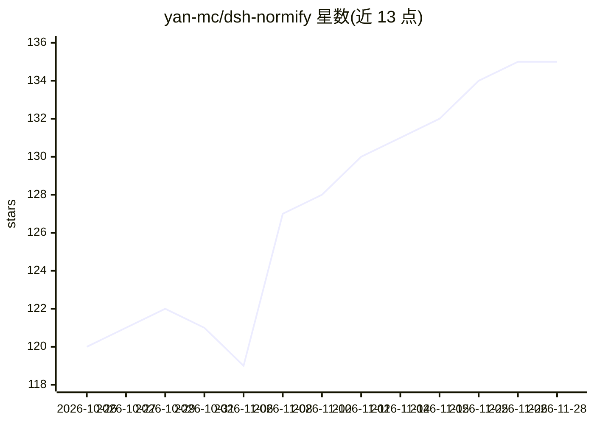

# yan-mc/dsh-normify

⭐ 135 · TypeScript · MIT · 推送 2026-11-03 · [GitHub](https://github.com/yan-mc/dsh-normify) · 个人维护 · 中文 README

**给 DSH 环境里的 AI 提供架构树建模与漂移校验的插件**

Normify 是 DeepSeek Harness（DSH）的插件，提供 normify-gen 技能与 7 个原语工具（旧 31 个工具名可过渡使用），让 AI 把仓库分析成分形模块树结构数据，并按「计划态建树 → 逐个实现 → 关单收尾」的伴随式开发流程工作。确定性引擎负责 L1 写时 / L2 全项目 / L3 冻结三层校验与编译，产出 tree.json 等五件产物加 receipt.sha256 回执链，并用 fingerprint 检出代码与结构数据的漂移。以 DSH bundle 形式分发，只支持 DSH 0.2.x；从源码安装需先 npm install && npm run build。

## 筛选速览

| 维度 | 判定 | 备注 |
|---|---|---|
| AI 角色 | `ai-ecosystem` | LLM/agent 周边工具 |
| 许可风险 | `permissive` | MIT |
| 部署形态 | `library` | 以包/库形式分发 |
| 模型依赖 | locked-api |  |
| 硬件要求 | — | 无带数字的原话,不猜 |
| 安装摩擦 | `low` | 无编译、无系统依赖或容器化 |
| 成熟度 | — | 结构信号不足 |

## 能力要点

- 7 个 normify_* 原语工具 + normify-gen 技能，按 op 分派
- 三层校验（写时/validate/build）fail-closed，诊断带可修复提示
- normify_check{op:"drift"} 用 git diff 定位指纹漂移，change close 强制 0 error
- 单文件零依赖交互式架构图 normify.html，支持 API 直连箭头与下钻

## 适用场景

- 为现有仓库生成可下钻、带 API 锚定箭头的交互式架构图
- AI 写代码前先建模块树，实施后关单收尾保持图与代码同步
- 用 policy.yml 声明依赖方向/禁依赖/无环等架构规则并强制校验

## 场景标签

`编码 Agent` · 领域:编码与开发

## 证据(README 行号)

> L16: Normify 是 **DeepSeek Harness（DSH）插件**，也是**一套写给 AI 用的开发流程**：
> L18: - **给 AI 的**：`normify-gen` 技能 + **7 个原语工具**（`normify_project` / `read` / `write` / `check` / `build` /
> L226: Normify 以 **DSH bundle** 形式分发，只支持 **DSH 0.2.x**（`engines.dsh: ">=0.2.1-rc.1 <0.3.0"`）。

## 星数曲线

2026-10-26 120 → 2026-11-28 135（+15）

---
*卡片 v1 · prompt 1.4 · 生成 2026-11-28 · 置信度 high · 依据 README sha `1217d33895ed` · [字段定义](../../DATASET.md)*
