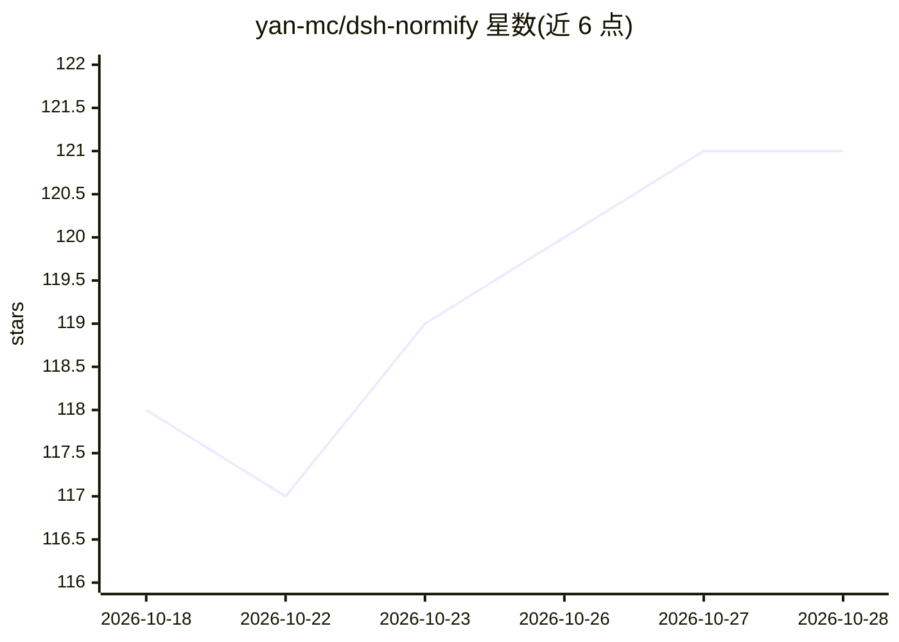

# yan-mc/dsh-normify

⭐ 121 · TypeScript · MIT · 推送 2026-09-13 · [GitHub](https://github.com/yan-mc/dsh-normify) · 个人维护 · 中文 README

**DSH 插件：让 AI 把项目建成可校验的分形模块树并渲染架构图**

面向 DeepSeek Harness（DSH）的插件，提供 31 个 normify_* 工具与 normify-gen 技能，供 AI 把仓库分析成模块树结构数据（模块=Markdown 文件、路径式 id、两类边），并按伴随式流程（change_open → brief → check → 实施 → refresh → change_close）先建图后编程。引擎侧执行三层零容忍校验（写时 L1 / 全项目 L2 / 冻结回执 L3）、确定性编译 tree.json 等产物（SHA-256 冻结），并按 policy.yml 架构规则强制约束依赖方向、无环等。渲染器输出零依赖单文件交互式 HTML 架构图，支持逐层下钻、API 直连箭头、中英切换。通过 npm 构建 tgz 或 dsh plugin 命令安装；深度不设上限，增量再生成只重建受影响子树。

## 筛选速览

| 维度 | 判定 | 备注 |
|---|---|---|
| AI 角色 | `ai-ecosystem` | LLM/agent 周边工具 |
| 许可风险 | `permissive` | MIT |
| 部署形态 | `library` | 以包/库形式分发 |
| 模型依赖 | locked-api |  |
| 硬件要求 | — | 无带数字的原话,不猜 |
| 安装摩擦 | `low` | 无编译、无系统依赖或容器化 |
| 成熟度 | — | 结构信号不足 |

## 能力要点

- 31 个 normify_* 工具 + normify-gen 技能，AI 先建图后编程、伴随编程改图
- 三层 fail-closed 校验（L1 写时 / L2 全项目 / L3 编译冻结），change_close 0 error 强制收尾
- policy.yml 架构规则（依赖方向/禁依赖/无环/跨树/命名）由 validate 强制执行
- 渲染为零依赖单文件 HTML：逐层下钻、API 直连箭头、深链接、中英切换

## 适用场景

- 让 DSH 中的 AI 为整个仓库生成并持续维护可下钻的架构图
- 开发前先建计划态模块树，实现后自动激活并保持代码与结构数据同步
- 用架构规则（无环、依赖方向）在 CI 门禁中约束设计
- 产出单文件交互式架构图直接归档或分享给他人阅读

## 场景标签

 · 领域:开发者工具/软件架构

## 证据(README 行号)

> L16: Normify 是 **DeepSeek Harness（DSH）插件**，也是**一套写给 AI 用的开发流程**：
> L18: - **给 AI 的**：`normify-gen` 技能 + **31 个 `normify_*` 工具** —— 让模型把仓库分析成模块树结构数据，

## 星数曲线

2026-10-18 118 → 2026-10-28 121（+3）

---
*卡片 v1 · prompt 1.4 · 生成 2026-10-23 · 置信度 high · 依据 README sha `d511685a26dd` · [字段定义](../../DATASET.md)*
