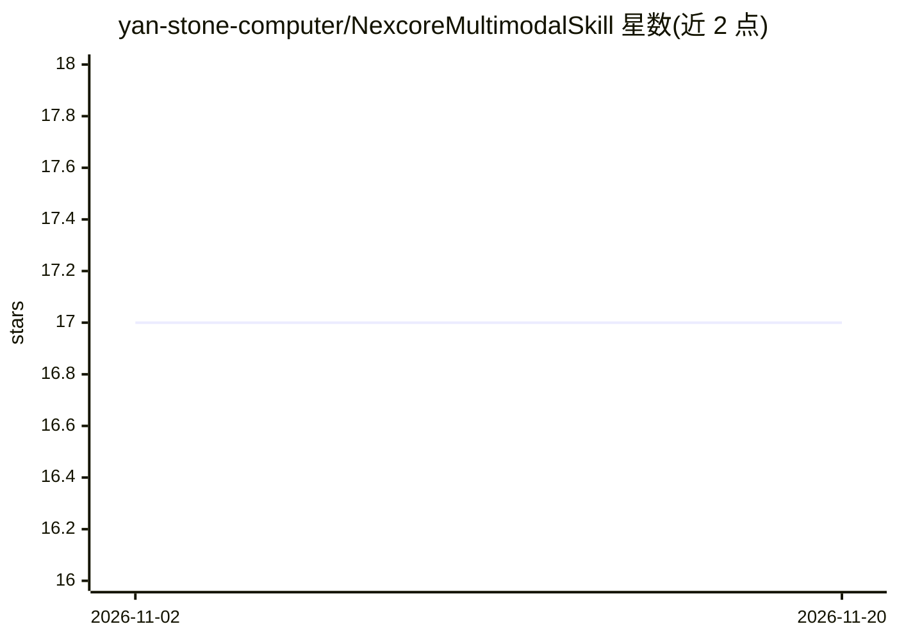

# yan-stone-computer/NexcoreMultimodalSkill

⭐ 17 · Python · MIT · 推送 2026-11-01 · [GitHub](https://github.com/yan-stone-computer/NexcoreMultimodalSkill) · 个人维护 · 中文 README

**给纯文本 Agent 添加视觉证据与图像/视频生成能力的技能包**

以 Agent Skill（SKILL.md + Python 脚本）形式提供四种能力：NexcoreVision 本地 OCR + 可选 CNN + 独立视觉模型的有界证据报告、PDF/Office 解析与多引擎回退（web→GLM→Qwen→SiliconFlow→Gemini→MinerU→本地 OCR）、经 Agnes API 的图像/视频生成，以及基于用户自有 ComfyUI 的 Qwen-Image-2.1 本地生图。面向 Claude Code/Codex/Cursor 等 Agent 平台，安装器可写入各平台原生配置。限制：ComfyUI 本地安装需 NVIDIA 8 GiB VRAM、约 10.4 GiB 模型下载且 Qwen 权重为 Research License 非商用；多数视觉路线需至少一个 API key。

## 筛选速览

| 维度 | 判定 | 备注 |
|---|---|---|
| AI 角色 | `ai-ecosystem` | LLM/agent 周边工具 |
| 许可风险 | `permissive` | MIT |
| 部署形态 | `None` |  |
| 模型依赖 | — | README 未给出锁定关系 |
| 硬件要求 | `gpu-8g` | |
| 安装摩擦 | `low` | 无编译、无系统依赖或容器化 |
| 成熟度 | — | 结构信号不足 |

## 能力要点

- OCR/CNN/视觉模型三源分离的视觉证据管线，图像文本按不可信数据处理
- 多引擎视觉回退链与 PDF/Office 文档解析（MinerU 转 Markdown）
- 一键安装本地 ComfyUI v0.42.0 + Qwen-Image-2.1（SHA-256 校验、低显存模式）
- 支持 Claude Code/Codex/OpenCode/Cursor/Trae/WorkBuddy 六个平台的原生集成

## 适用场景

- 让我只有文本能力的 Agent 能查看截图并核对其中的信息
- 在本地 ComfyUI 上生成或编辑图像而不外发数据
- 让 Agent 解析 PDF/Office 文档并提取关键内容

## 场景标签

`图像生成` `视频生成` `文档解析` `OCR` · 领域:内容生成

## 证据(README 行号)

> L11: NexcoreMultimodalSkill combines four capabilities in one Agent Skill:
> L222: The repository contains a standard `SKILL.md`, so it can be copied into any

## 星数曲线

2026-11-02 17 → 2026-11-20 17（+0）

---
*卡片 v1 · prompt 1.4 · 生成 2026-11-18 · 置信度 high · 依据 README sha `a03a6a7f65db` · [字段定义](../../DATASET.md)*
