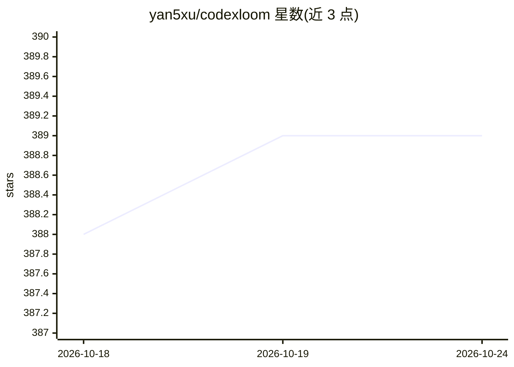

# yan5xu/codexloom

⭐ 389 · Go · NOASSERTION · 推送 2026-08-20 · [GitHub](https://github.com/yan5xu/codexloom) · 个人维护 · 中文 README

**为 Codex 长期领域 Agent 提供治理与编组的工作环境**

构建于 Codex 之上的本地自托管运行环境：将 Codex 线程转化为长期领域 Agent 的持续工作区，为 Agent 提供稳定 ID、名称、Profile 与主线程，通过有界消息、Topic、Owner 决策与受管 Artifact 实现 Agent 间协作与人工治理，并可经飞书/Slack/Parall 的 Interface Agent 对外交付。同一线程可在 Codex Desktop、Mobile、WebUI 与 CLI 间同步使用。当前面向单个高级个人 Owner，企业多租户非主要方向。从源码构建启动，需先安装 codex CLI 并用 ChatGPT 账号登录。

## 筛选速览

| 维度 | 判定 | 备注 |
|---|---|---|
| AI 角色 | `ai-ecosystem` | LLM/agent 周边工具 |
| 许可风险 | `none` | NOASSERTION |
| 部署形态 | `None` |  |
| 模型依赖 | — | README 未给出锁定关系 |
| 硬件要求 | — | 无带数字的原话,不猜 |
| 安装摩擦 | `low` | 无编译、无系统依赖或容器化 |
| 成熟度 | `idea` | |

## 能力要点

- 将 Codex 线程转为长期领域 Agent 的持续工作区
- Agent 间有界消息、Topic 协调与 Owner 决策（Needs You）
- 经飞书/Slack/Parall 的 Interface Agent 治理对外交付
- 同一主线程跨 Desktop/Mobile/WebUI/CLI 多端同步

## 适用场景

- 长期维护多个专门领域的 Codex Agent 并让它们协作
- 让同事通过飞书或 Slack 与受治理的 Agent 协作
- 避免每次新任务重复交代背景、复用已积累的工作上下文

## 场景标签

`多智能体` `Agent 框架` · 领域:Agent 开发

## 证据(README 行号)

> L29: CodexLoom is built on Codex. It does not reimplement the agent runtime or
> L30: duplicate thread history. Instead, it turns a Codex thread into the continuing
> L56: - **Long-lived agents:** Maintain a stable identity, editable name, primary thread, Profile, and model configuratio

## 星数曲线

2026-10-18 388 → 2026-10-24 389（+1）

---
*卡片 v1 · prompt 1.4 · 生成 2026-10-22 · 置信度 high · 依据 README sha `d67448b8487c` · [字段定义](../../DATASET.md)*
