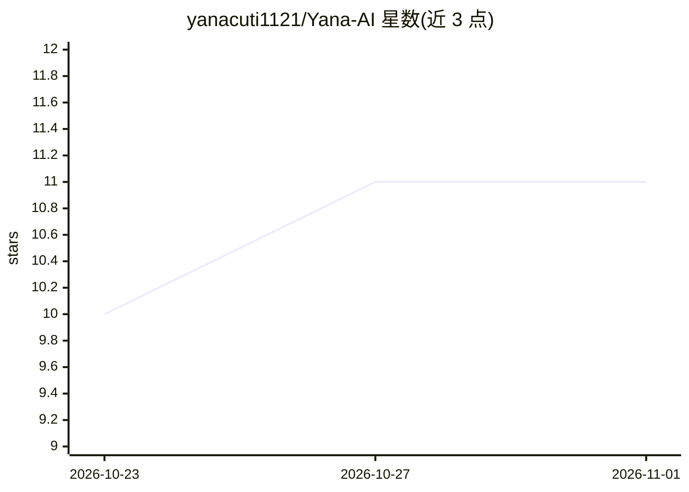

# yanacuti1121/Yana-AI

⭐ 11 · Python · Apache-2.0 · 推送 2026-10-31 · [GitHub](https://github.com/yanacuti1121/Yana-AI) · [官网](https://yana.vutam.link/) · 个人维护 · 中文 README

**本地优先的 AI 代理治理控制平面：管控模型可访问与执行的范围**

介于 AI 模型与机器实际权限之间的本地控制平面：以 Rust 运行时 yana-rt 统一回合循环与权限校验，通过 capability manifests、人工审批、哈希链审计日志与 SHA-256 core-lock 决定模型提议的动作是否被允许。支持 19 个模型提供方（13 云端 6 本地）、4 种 agent 宿主适配（Claude Code、Codex、Cursor、Antigravity），并提供桌面工作区 Yana Studio（文件、终端、聊天、治理遥测）。可选的 Giám Thị 看护器定期比对基线并在漂移时锁停后续工具调用。部分能力（Yana OS 等）仍在开发中；macOS 构建未公证，无 Linux ARM 构建。

## 筛选速览

| 维度 | 判定 | 备注 |
|---|---|---|
| AI 角色 | `ai-ecosystem` | LLM/agent 周边工具 |
| 许可风险 | `permissive` | Apache-2.0 |
| 部署形态 | `desktop` | 安装包/桌面程序 |
| 模型依赖 | local-ok | 支持本地模型 |
| 硬件要求 | — | 无带数字的原话,不猜 |
| 安装摩擦 | `low` | 无编译、无系统依赖或容器化 |
| 成熟度 | `idea` | |

## 能力要点

- Rust 运行时 yana-rt 统一回合循环与权限校验（41 个子命令）
- capability manifests、人工审批、哈希链审计日志与 SHA-256 core-lock 治理机制
- 19 个模型提供方（13 云端 6 本地）与 4 种 agent 宿主适配
- Giám Thị 独立看护器：检测漂移后锁停所有后续工具调用，仅人工可解锁

## 适用场景

- 给已在使用的编码 agent（Claude Code/Codex/Cursor）加上权限与审批控制
- 在一个本地界面里运行多家云端与本地模型并查看治理遥测
- 审计 AI agent 做过什么、被拦截了什么及原因

## 场景标签

`Agent 框架` `模型网关` · 领域:Agent 开发

## 证据(README 行号)

> L5:  A local control plane that sits between any AI model and real power over your machine.
> L74: A model can say what it wants to do. Yana decides whether that is allowed, and a
> L149: A single Rust binary owns the turn loop and the authority check for every client, so

## 星数曲线

2026-10-23 10 → 2026-11-01 11（+1）

---
*卡片 v1 · prompt 1.4 · 生成 2026-11-01 · 置信度 high · 依据 README sha `b38d586de81e` · [字段定义](../../DATASET.md)*
