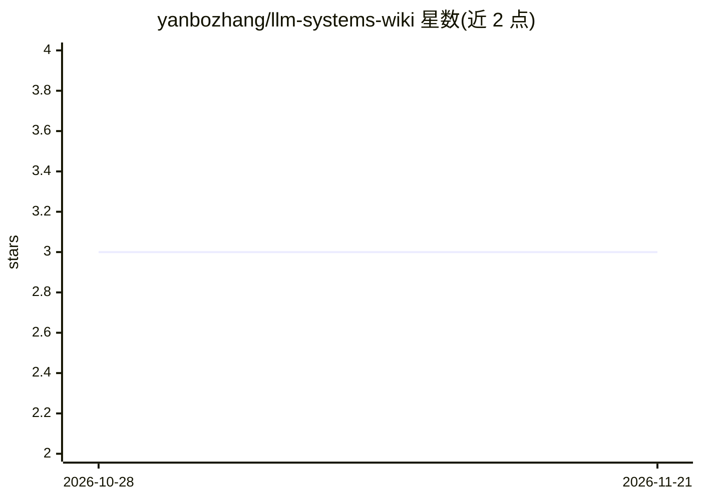

# yanbozhang/llm-systems-wiki

⭐ 3 · Python · MIT · 推送 2026-11-20 · [GitHub](https://github.com/yanbozhang/llm-systems-wiki) · [官网](https://yanbozhang.github.io/llm-systems-wiki/) · 个人维护 · 中文 README

**中文大模型与 Agent 系统学习 Wiki：45 主题、135 知识点**

一本中文工程学习手册，把论文、官方文档与固定版本源码拆解为可推导、可运行的知识点：7 个模块覆盖模型网络、训练、推理、Agent Harness、RAG、业务 Agent 与 Benchmark，配 45 份 Python 教学示例、公式推导与 Mermaid 结构图。面向希望理解 LLM 内部机制的开发者。示例仅依赖 Python 3.11+ 标准库，无需 API Key、GPU 或联网；网站通过 GitHub Pages 发布，支持全文搜索与中英文导航，知识正文目前为中文。

## 筛选速览

| 维度 | 判定 | 备注 |
|---|---|---|
| AI 角色 | `ai-knowledge` | 知识聚合/清单类 |
| 许可风险 | `permissive` | MIT |
| 部署形态 | `None` |  |
| 模型依赖 | — | README 未给出锁定关系 |
| 硬件要求 | — | 无带数字的原话,不猜 |
| 安装摩擦 | `low` | 无编译、无系统依赖或容器化 |
| 成熟度 | — | 结构信号不足 |

## 能力要点

- 45 个主题、135 个知识点，附公式推导与固定提交源码导读
- 45 份 Python 教学示例仅依赖标准库，无需 API Key/GPU/联网
- 七模块知识地图覆盖训练、推理、RAG、Harness 与 Benchmark
- 网站提供全文搜索、学习路径与中英文导航

## 适用场景

- 系统学习 Transformer、训练与推理的底层公式
- 通过教学示例理解 KV 缓存、LoRA、DPO 等机制
- 了解 Codex CLI、Claude Code、Mobile-Agent 等工程架构
- 为 Agent 与 Benchmark 研究查找论文与源码版本索引

## 场景标签

`教程课程` · 领域:学习与行业

## 证据(README 行号)

> L9: 一本持续更新的中文工程学习手册：把论文、官方文档和固定版本源码拆成可以推导、运行、画图解释的知识点。面向希望理解 Transformer、训练与推理、RAG、Agent Harness 和 Benchmark 的开发者。
> L15: **v1.0：7 个模块 · 45 个主题 · 135 个知识点 · 45 份 Python 教学示例。** 每个知识点都有公式与符号说明、代码与步骤解释、Mermaid 实现图、原始来源与边界条件。
> L69: 示例仅依赖 **Python 3.11+ 标准库**，不需要 API Key、GPU 或联网：

## 星数曲线

2026-10-28 3 → 2026-11-21 3（+0）

---
*卡片 v1 · prompt 1.4 · 生成 2026-11-21 · 置信度 high · 依据 README sha `4ef04ef9c05a` · [字段定义](../../DATASET.md)*
