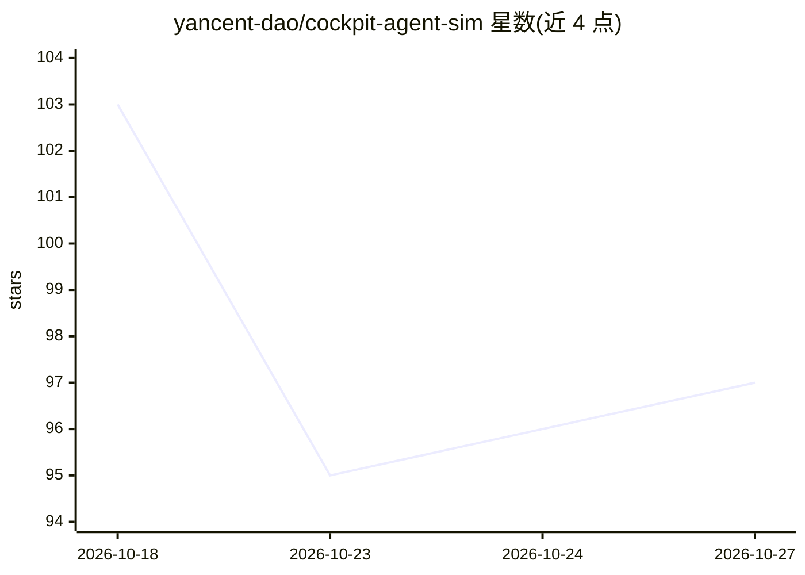

# yancent-dao/cockpit-agent-sim

⭐ 97 · TypeScript · MIT · 推送 2026-10-23 · [GitHub](https://github.com/yancent-dao/cockpit-agent-sim) · 个人维护 · 中文 README

**智能座舱 Agent 演示框架：车辆信号模拟+Agent 运行时全栈底座**

面向智能座舱业务的 Agent 框架与演示底座：包含 113 个对齐 COVESA VSS v6.0 的车辆信号模拟、Agent 运行时（快慢双层、子 Agent 委派）、94 个工具、四级记忆、约束引擎、黑灰彩三级权限与带 token 的确认流，以及卡片编排和 TTS 语音链路；导航、天气、音乐等接真实三方服务。零后端、运行时依赖为零（仅 vite/vitest/typescript 三个 devDependency），遵循'加能力=加数据不加代码'。明确定位为演示底座而非量产产品：无 ASR、机酒价格为示例数据。开发者通过 npm 安装并配置 OpenRouter/高德 Key 启动。

## 筛选速览

| 维度 | 判定 | 备注 |
|---|---|---|
| AI 角色 | `ai-ecosystem` | LLM/agent 周边工具 |
| 许可风险 | `permissive` | MIT |
| 部署形态 | `library` | 以包/库形式分发 |
| 模型依赖 | — | README 未给出锁定关系 |
| 硬件要求 | — | 无带数字的原话,不猜 |
| 安装摩擦 | `low` | 无编译、无系统依赖或容器化 |
| 成熟度 | `idea` | |

## 能力要点

- 113 个车辆信号对齐 COVESA VSS v6.0，94 个工具按域分组
- 快慢双层 Agent 执行架构与一层深度子 Agent 委派
- 黑灰彩三级权限 + 对齐 MCP MRTR 的带 token 确认流
- 零后端、运行时依赖为零，可构建单文件版（node build-single.mjs）

## 适用场景

- 在智能座舱仿真环境中开发与演示车控、导航、媒体等 Agent 场景
- 基于 VSS 信号模拟与权限/确认机制做座舱 Agent 原型验证
- 复用绘本、旅行助手等长场景做 Agent 行为的 Pilot 评测

## 场景标签

`Agent 框架` · 领域:Agent 开发

## 证据(README 行号)

> L3: **一个面向智能座舱业务的 Agent 框架**——车辆信号模拟、Agent 运行时、工具系统、记忆系统、AI HMI、TTS 全栈覆盖，新增场景理想情况下只需要新增一个 Skill。
> L62: - **平台不认识任何具体 Agent。** Agent 靠 `agents/*/manifest.ts` 注册。验收标准：新建一个只挂 3 个 Tool 的 Agent，不改平台一行代码就能跑。
> L36: > 这是一个**演示底座**而非量产产品：没有 ASR（文字输入代替）、没有后端、机酒价格暂为带标记的示例数据。它优化的目标是"每次做新 Demo 不用从零开始"。

## 星数曲线

2026-10-18 103 → 2026-10-27 97（-6）

---
*卡片 v1 · prompt 1.4 · 生成 2026-10-23 · 置信度 high · 依据 README sha `46093cb488c3` · [字段定义](../../DATASET.md)*
