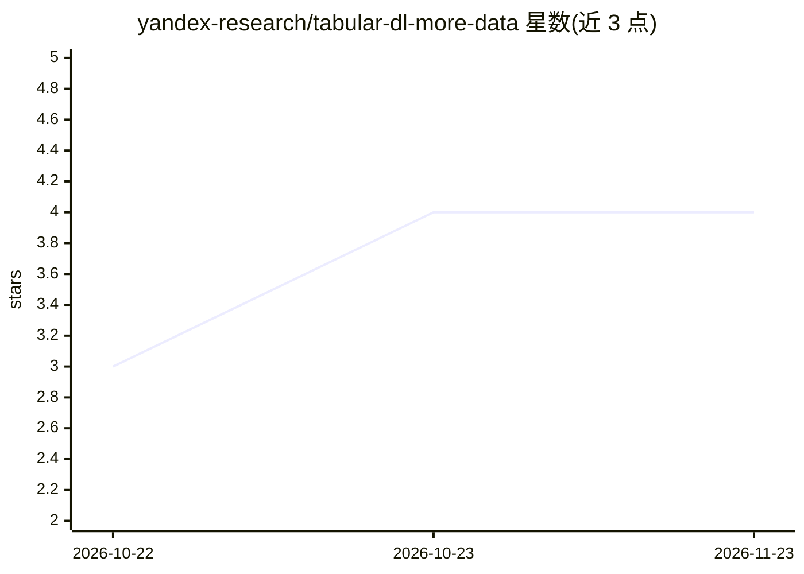

# yandex-research/tabular-dl-more-data

⭐ 4 · Python · Apache-2.0 · 推送 2026-10-20 · [GitHub](https://github.com/yandex-research/tabular-dl-more-data) · [官网](https://arxiv.org/abs/2610.26794) · 组织维护

**表格机器学习数据规模扩展规律的研究代码与结果**

论文《On Data Scaling in Tabular ML》的配套代码库：在八个真实数据集上研究训练数据规模扩展，比较 MLP、MLP-PLE、TabM、树模型、TabPack 与基础模型在不同训练规模下的表现。以 uv 管理 Python 环境，每个方法/数据集/规模组合独立运行 tuning 与 evaluation 两阶段，支持 --resume 续跑，基础模型与 Kumo 需额外依赖组，预训练权重不含在内。

## 筛选速览

| 维度 | 判定 | 备注 |
|---|---|---|
| AI 角色 | `ai-knowledge` | 知识聚合/清单类 |
| 许可风险 | `permissive` | Apache-2.0 |
| 部署形态 | `None` |  |
| 模型依赖 | — | README 未给出锁定关系 |
| 硬件要求 | — | 无带数字的原话,不猜 |
| 安装摩擦 | `low` | 无编译、无系统依赖或容器化 |
| 成熟度 | — | 结构信号不足 |

## 能力要点

- 八个真实数据集上的训练数据规模扩展实验
- 覆盖 MLP/MLP-PLE/TabM/树模型/TabPack/基础模型
- tuning（TPE 100 trials）+ 10-seed evaluation 两阶段流程
- --resume 支持跳过已完成运行

## 适用场景

- 复现论文中表格 ML 数据规模扩展的实验结果
- 在自己的数据集上对比不同表格模型随数据量增长的表现
- 研究分布偏移下验证数据使用方式对收益的影响

## 场景标签

`科研工具` · 领域:学习与行业

## 证据(README 行号)

> L3: Code and results for *On Data Scaling in Tabular ML: More Data, Better Generalization?*.
> L8: ## Run

## 星数曲线

2026-10-22 3 → 2026-11-23 4（+1）

---
*卡片 v1 · prompt 1.4 · 生成 2026-11-21 · 置信度 high · 依据 README sha `6283a3cfb6d6` · [字段定义](../../DATASET.md)*
