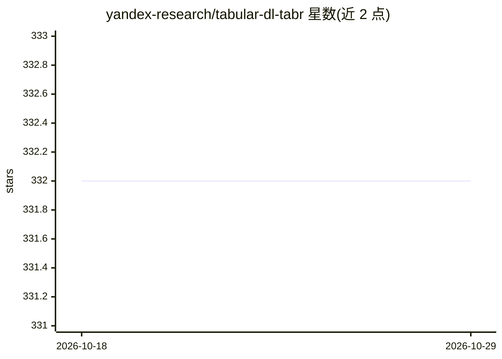

# yandex-research/tabular-dl-tabr

⭐ 332 · Python · MIT · 推送 2025-11-17 · [GitHub](https://github.com/yandex-research/tabular-dl-tabr) · [官网](https://arxiv.org/abs/2307.14338) · 组织维护

**TabR 论文官方实现：检索增强的表格深度学习模型**

Yandex Research 发布的论文《TabR: Unlocking the Power of Retrieval-Augmented Tabular Deep Learning》官方 PyTorch 实现，面向复现论文实验的研究者。核心模型 TabR 在训练与推理时从训练集中检索上下文样本增强表格预测；仓库同时收录 MLP、FT-Transformer、XGBoost/LightGBM/CatBoost、KNN、DNNR 等基线实现，并提供调参、多随机种子评估与集成脚本及实验配置。需 conda 类环境管理器搭建环境、下载基准数据集，GPU 环境下运行并显式设置 CUDA_VISIBLE_DEVICES；README 顶部提示关注后续模型 TabM。

## 筛选速览

| 维度 | 判定 | 备注 |
|---|---|---|
| AI 角色 | `ai-native` | 本体是模型或模型工具 |
| 许可风险 | `permissive` | MIT |
| 部署形态 | `None` |  |
| 模型依赖 | — | README 未给出锁定关系 |
| 硬件要求 | — | 无带数字的原话,不猜 |
| 安装摩擦 | `medium` | 含编译或系统依赖之一 |
| 成熟度 | — | 结构信号不足 |

## 能力要点

- TabR 检索增强表格深度学习模型官方实现（含 context freeze 等变体）
- 收录 XGBoost/LightGBM/CatBoost/FT-Transformer/DNNR 等多个基线实现
- 提供 tune/evaluate/ensemble 全流程复现脚本与实验配置
- 支持添加自定义数据集（.npy 数值/二值/类别特征）

## 适用场景

- 复现 TabR 论文中的表格学习实验结果
- 在自建表格数据集上运行检索增强深度学习模型
- 对比 TabR 与梯度提升等表格学习基线

## 场景标签

 · 领域:机器学习研究/表格数据

## 证据(README 行号)

> L6: This is the official implementation of the paper "TabR: Unlocking the Power of Retrieval-Augmented Tabular Deep Lear
> L156:  - `tabr.py` is the "main" implementation of TabR with many useful technical comments inside

## 星数曲线

2026-10-18 332 → 2026-10-29 332（+0）

---
*卡片 v1 · prompt 1.4 · 生成 2026-10-21 · 置信度 high · 依据 README sha `b0789cd05bc8` · [字段定义](../../DATASET.md)*
