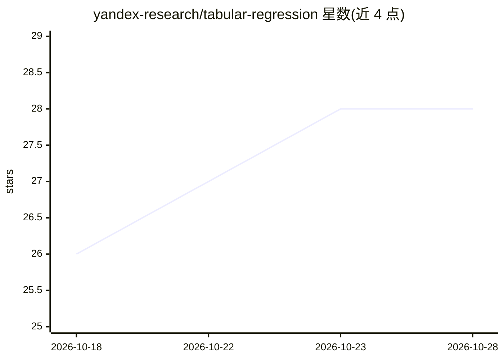

# yandex-research/tabular-regression

⭐ 28 · Python · 推送 2026-10-07 · [GitHub](https://github.com/yandex-research/tabular-regression) · [官网](https://arxiv.org/abs/2610.13909) · 组织维护

**表格深度回归论文代码：18 种回归目标与早停研究复现**

论文《Revisiting Tabular Deep Regression: Objectives and the Limits of Global Early Stopping》的官方代码库：在 41 个 BeyondArena 数据集上比较 18 种回归目标，覆盖 MLP、TabM、TabPack、RealMLP 骨干，并研究不确定性依赖的早停与 AdaQR（联合学习输入依赖平滑与分位数预测）。仓库含调参/评估/集成入口脚本、已发布配置与机器可读报告；数据需从 Figshare 单独下载。环境用 uv 安装（Python 3.12.9 + PyTorch 2.7.1），从仓库根目录运行并用 CUDA_VISIBLE_DEVICES 选择加速器。

## 筛选速览

| 维度 | 判定 | 备注 |
|---|---|---|
| AI 角色 | `ai-native` | 本体是模型或模型工具 |
| 许可风险 | `none` | — |
| 部署形态 | `desktop` | 安装包/桌面程序 |
| 模型依赖 | — | README 未给出锁定关系 |
| 硬件要求 | — | 无带数字的原话,不猜 |
| 安装摩擦 | `low` | 无编译、无系统依赖或容器化 |
| 成熟度 | — | 结构信号不足 |

## 能力要点

- 18 种回归目标 × 4 种骨干（MLP/TabM/TabPack/RealMLP）的系统比较
- AdaQR：联合学习输入依赖平滑与分位数预测
- 不确定性依赖的 cohort 早停机制（5 或 10 cohorts）
- 保留全部调参配置与 15 种子的机器可读评估报告

## 适用场景

- 复现论文中的回归目标比较与 AdaQR 实验
- 基于已发布配置在指定数据集上复跑训练与集成
- 查阅各数据集的选中超参数与完整评估报告

## 场景标签

`模型评测` · 领域:评测与运维

## 证据(README 行号)

> L6: We compare 18 regression objectives on 41 BeyondArena datasets and study selected
> L8: uncertainty-dependent early stopping and Adaptive Quantile Regression (AdaQR),

## 星数曲线

2026-10-18 26 → 2026-10-28 28（+2）

---
*卡片 v1 · prompt 1.4 · 生成 2026-10-26 · 置信度 high · 依据 README sha `989a2ce190a7` · [字段定义](../../DATASET.md)*
