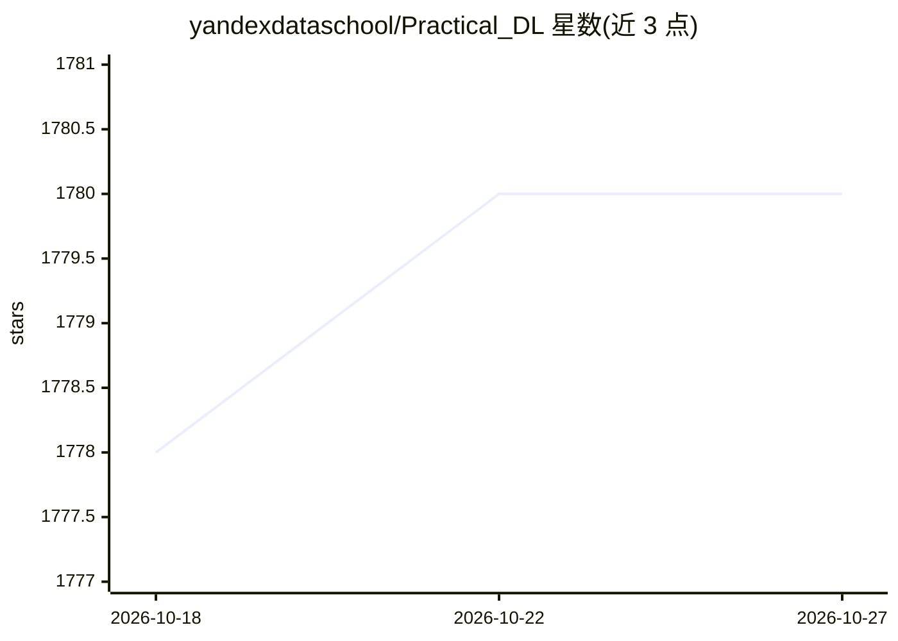

# yandexdataschool/Practical_DL

⭐ 1,780 · Jupyter Notebook · MIT · 推送 2026-10-24 · [GitHub](https://github.com/yandexdataschool/Practical_DL) · 组织维护

**YSDA/HSE/Skoltech 合作的深度学习课程材料库**

深度学习课程的讲义与实践材料仓库，由 Yandex Data School、HSE 与 Skoltech 合作开发。内容按周组织在 week* 文件夹中，涵盖反向传播与优化、PyTorch 基础、CNN 等主题的讲座、seminar 笔记本与作业；作业可在本地或 Google Colab 完成。课程含俄语 Telegram 群、截止日期与评分规则页，材料由多位讲师与学生共同维护。

## 筛选速览

| 维度 | 判定 | 备注 |
|---|---|---|
| AI 角色 | `ai-knowledge` | 知识聚合/清单类 |
| 许可风险 | `permissive` | MIT |
| 部署形态 | `None` |  |
| 模型依赖 | — | README 未给出锁定关系 |
| 硬件要求 | — | 无带数字的原话,不猜 |
| 安装摩擦 | `low` | 无编译、无系统依赖或容器化 |
| 成熟度 | — | 结构信号不足 |

## 能力要点

- 按周组织的讲座、seminar 笔记本与作业（week* 文件夹）
- 作业可在本地或 Google Colab 中完成
- 涵盖 numpy 神经网络、PyTorch、CNN 等主题

## 适用场景

- 系统学习深度学习基础并动手完成作业
- 获取高校深度学习课程的教学笔记本与讲义

## 场景标签

`教程课程` · 领域:学习与行业

## 证据(README 行号)

> L1: # Deep learning course
> L5: Lecture and practice materials for each week are in ./week* folders. You can complete all asignments locally or in g

## 星数曲线

2026-10-18 1,778 → 2026-10-27 1,780（+2）

---
*卡片 v1 · prompt 1.4 · 生成 2026-10-21 · 置信度 high · 依据 README sha `374df797787a` · [字段定义](../../DATASET.md)*
