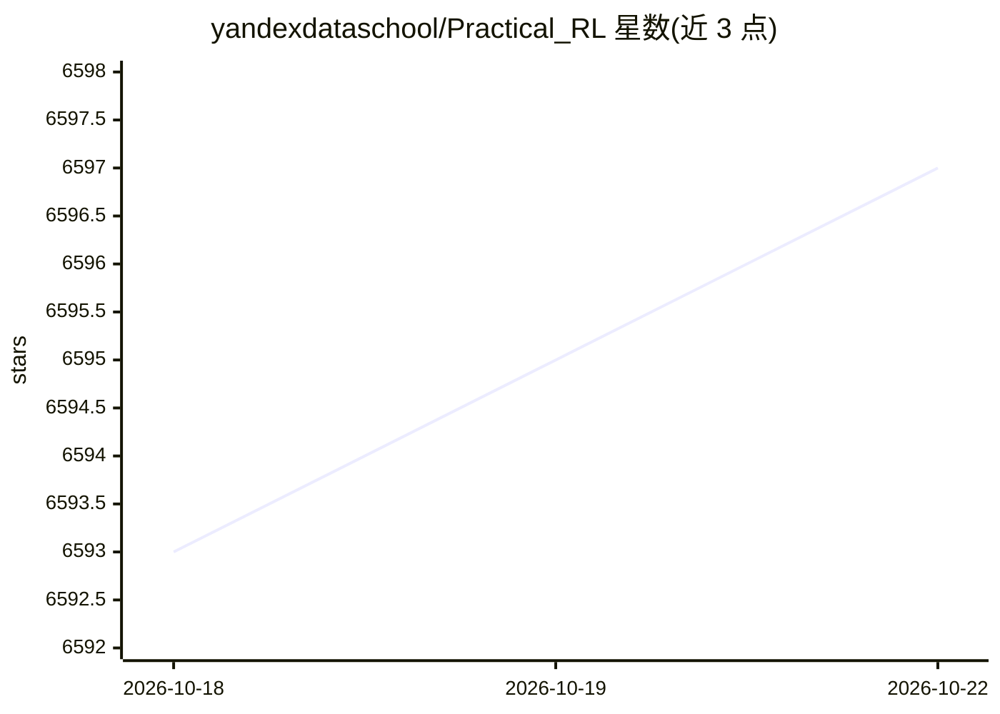

# yandexdataschool/Practical_RL

⭐ 6,597 · Jupyter Notebook · Unlicense · 推送 2026-10-20 · [GitHub](https://github.com/yandexdataschool/Practical_RL) · 组织维护

**面向在线学生的强化学习实战开放课程**

Yandex Data School 与 HSE 在校内讲授、并面向在线学生维护的强化学习开放课程：含约 10 周教学大纲（CEM、值迭代、Q-learning、深度 RL、探索、策略梯度、POMDP、PPO/TRPO、基于模型的 RL 与模仿学习等），每周配讲座、研讨与作业 notebook。课程强调实用技巧与动手实验，本地安装依赖运行，或通过 Google Colab / Azure Notebooks 打开，接受社区 Pull Request。

## 筛选速览

| 维度 | 判定 | 备注 |
|---|---|---|
| AI 角色 | `ai-knowledge` | 知识聚合/清单类 |
| 许可风险 | `permissive` | Unlicense |
| 部署形态 | `None` |  |
| 模型依赖 | — | README 未给出锁定关系 |
| 硬件要求 | — | 无带数字的原话,不猜 |
| 安装摩擦 | `low` | 无编译、无系统依赖或容器化 |
| 成熟度 | — | 结构信号不足 |

## 能力要点

- 覆盖从表格方法到深度 RL 与基于模型方法的完整教学大纲
- 每周配讲座、研讨与作业 notebook，作业含加分深入部分
- 支持本地运行依赖，亦可经 Google Colab / Azure Notebooks 学习
- 接受社区贡献的 git-course 模式

## 适用场景

- 系统学习强化学习从入门到高级主题
- 在 Colab 或本地动手完成 RL 实验
- 作为课程教材或自学路线参考

## 场景标签

`教程课程` `强化学习` · 领域:学习与行业

## 证据(README 行号)

> L3: An open course on reinforcement learning in the wild.
> L27: # Syllabus

## 星数曲线

2026-10-18 6,593 → 2026-10-22 6,597（+4）

---
*卡片 v1 · prompt 1.4 · 生成 2026-10-20 · 置信度 high · 依据 README sha `e3f619f1b91d` · [字段定义](../../DATASET.md)*
