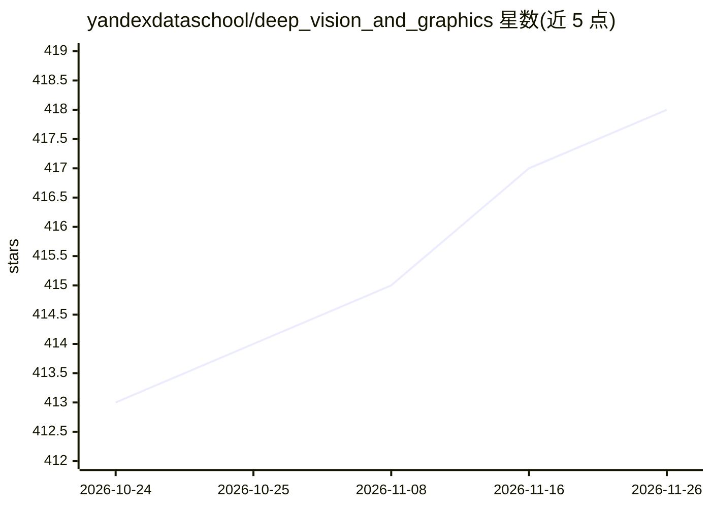

# yandexdataschool/deep_vision_and_graphics

⭐ 418 · Jupyter Notebook · MIT · 推送 2026-11-16 · [GitHub](https://github.com/yandexdataschool/deep_vision_and_graphics) · 组织维护

**YSDA 计算机视觉与图形学深度学习课程资料库**

YSDA 与 Skoltech 合作开设的《Deep Vision and Graphics》课程配套仓库，是 2015-2021 年《Deep Learning》课程的后续版本，侧重深度学习在计算机视觉中的应用。按周组织讲义与研讨课材料（./week* 目录），作业位于 ./homework* 目录。教学大纲覆盖卷积网络、transformer、分割与检测、生成模型（GAN、扩散模型）、多模态网络、点云处理、新视角合成（NeRF）等 12 周内容。行政事务与截止日期仅在 YSDA 内部 LMS 提供。

## 筛选速览

| 维度 | 判定 | 备注 |
|---|---|---|
| AI 角色 | `ai-knowledge` | 知识聚合/清单类 |
| 许可风险 | `permissive` | MIT |
| 部署形态 | `None` |  |
| 模型依赖 | — | README 未给出锁定关系 |
| 硬件要求 | — | 无带数字的原话,不猜 |
| 安装摩擦 | `low` | 无编译、无系统依赖或容器化 |
| 成熟度 | — | 结构信号不足 |

## 能力要点

- 按周组织的讲义、研讨课材料与作业（week*/homework* 目录）
- 12 周教学大纲覆盖检测分割、生成模型、点云、NeRF 等主题
- 课程材料问题通过 GitHub issue 反馈

## 适用场景

- 系统学习深度学习在计算机视觉与图形学中的应用
- 查阅生成模型、新视角合成等专题的课程讲义与作业
- 作为教师参考组织类似课程的教学材料

## 场景标签

`教程课程` · 领域:学习与行业

## 证据(README 行号)

> L3: This repo supplements course "Deep Vision and Graphics" taught at YSDA @fall'26.
> L6: Lecture and seminar materials for each week are in ./week* folders. Homeworks are in ./homework* folders.

## 星数曲线

2026-10-24 413 → 2026-11-26 418（+5）

---
*卡片 v1 · prompt 1.4 · 生成 2026-11-25 · 置信度 high · 依据 README sha `6d92491eca9b` · [字段定义](../../DATASET.md)*
