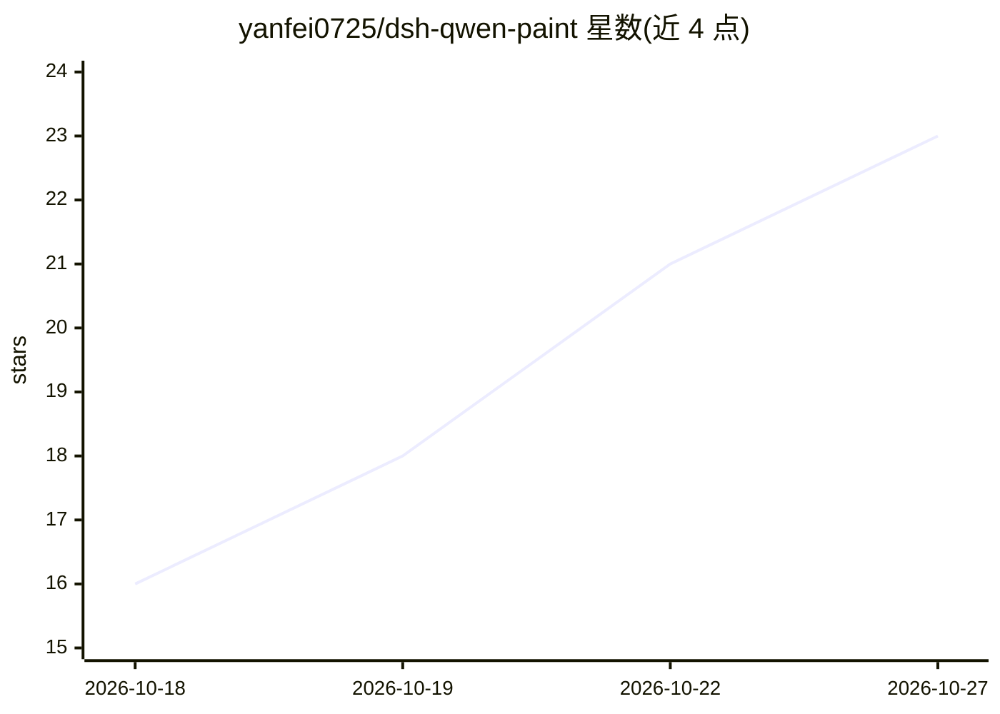

# yanfei0725/dsh-qwen-paint

⭐ 23 · JavaScript · MIT · 推送 2026-10-20 · [GitHub](https://github.com/yanfei0725/dsh-qwen-paint) · 个人维护 · 中文 README

**DeepSeek Harness 的本地文生图/图生图插件（经 ComfyUI 调 Qwen-Image）**

面向 DeepSeek Harness（DSH）的图像生成插件：通过本机 ComfyUI 调用 Qwen-Image 2.1 完成文生图、图生图与蒙版局部重绘，结果落盘并回显在会话界面。出图流量默认由代码层强制限制在 127.0.0.1，无需外部 API 密钥；可选的厂商加速包下载会访问 pip 源与 GitHub，可关闭。支持 OOM 自动分块解码回退、显存不足时串行抽卡、生成后自动放大、AI 挑图与用户自选图，适配 NVIDIA/Intel/AMD 显卡与 Windows/Linux。以 DSH 插件形式分发，兼容性经 0.2.1 系列 DSH 实测（覆盖加载/注册链路，不含端到端出图）。

## 筛选速览

| 维度 | 判定 | 备注 |
|---|---|---|
| AI 角色 | `ai-native` | 本体是模型或模型工具 |
| 许可风险 | `permissive` | MIT |
| 部署形态 | `desktop` | 安装包/桌面程序 |
| 模型依赖 | — | README 未给出锁定关系 |
| 硬件要求 | — | 无带数字的原话,不猜 |
| 安装摩擦 | `medium` | 含编译或系统依赖之一 |
| 成熟度 | — | 结构信号不足 |

## 能力要点

- 文生图/图生图/圈选局部重绘（ComfyUI 自带潜空间重绘，零额外权重）
- 网络边界由代码强制：默认仅 127.0.0.1，远程地址需用户显式开启
- OOM 自动回退分块解码、<16GB 显存自动串行抽卡、生成后自动放大
- 本机扩展 API（health/capabilities/presets/memory 端点，仅接受本机请求）

## 适用场景

- 在 DSH 对话中直接生成与局部修改图像
- 低显存机器上挂机批量抽卡并挑图
- 不想让提示词/图片出本机的本地优先绘图场景

## 场景标签

`图像生成` · 领域:内容生成

## 证据(README 行号)

> L3: 面向 **DeepSeek Harness** 的本地图像生成插件。经由本机 **ComfyUI** 调用 **Qwen-Image 2.1** 模型，
> L4: 在对话中直接完成文生图与图生图；生成的图像落盘保存，并在会话界面内直接呈现。

## 星数曲线

2026-10-18 16 → 2026-10-27 23（+7）

---
*卡片 v1 · prompt 1.4 · 生成 2026-10-27 · 置信度 mid · 依据 README sha `7fa6c94f695f` · [字段定义](../../DATASET.md)*
