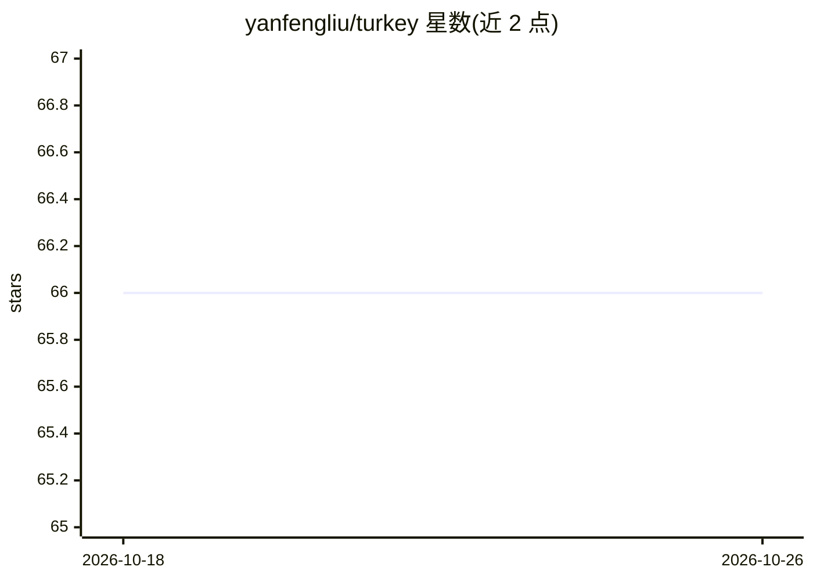

# yanfengliu/turkey

⭐ 66 · HTML · MIT · 推送 2026-09-02 · [GitHub](https://github.com/yanfengliu/turkey) · 个人维护

**在 Amazon Mechanical Turk 上众包图像分割标注的 Web UI 工具**

纯 JavaScript（jQuery/Bootstrap）编写的 MTurk 标注界面：将 src/Mturk.html 源码粘贴进 MTurk 自定义 HIT，用 CSV 批量下发图片 URI、标注模式与类别标签即可众包标注。支持 Polygon、Bounding Box、Dot、Link 四种模式，可按图配置模式与类别，导入人工或算法生成的历史标注，提供缩放/撤销/重置。附带 localDemo.html 供部署前本地测试（Chrome 需 --allow-file-access-from-files），并有 MATLAB 示例 UI 审核结果。仅完整测试于 Chrome，开发仍在进行中。

## 筛选速览

| 维度 | 判定 | 备注 |
|---|---|---|
| AI 角色 | `ai-ecosystem` | LLM/agent 周边工具 |
| 许可风险 | `permissive` | MIT |
| 部署形态 | `None` |  |
| 模型依赖 | — | README 未给出锁定关系 |
| 硬件要求 | — | 无带数字的原话,不猜 |
| 安装摩擦 | `low` | 无编译、无系统依赖或容器化 |
| 成熟度 | `idea` | |

## 能力要点

- Polygon/BBox/Dot/Link 四种标注模式，按图配置模式与类别
- CSV 批量下发图片，可导入历史标注（人工或算法生成）
- localDemo.html 本地测试与 MATLAB 标注审核示例 UI
- 界面支持缩放、删除、撤销、重置

## 适用场景

- 通过 MTurk 众包实例分割/目标检测训练数据
- 导入已有标注供众包工人增量修正
- 标注结果审核后批量回传 MTurk 处理

## 场景标签

 · 领域:计算机视觉/数据标注

## 证据(README 行号)

> L11: **turkey** lets you easily create a web UI on Amazon Mechanical Turk to crowd-source image annotation data. Its mai
> L14: - Currently support Polygon, Bounding Box, Dot, and Link annotation modes

## 星数曲线

2026-10-18 66 → 2026-10-26 66（+0）

---
*卡片 v1 · prompt 1.4 · 生成 2026-10-24 · 置信度 mid · 依据 README sha `9184ec8264d7` · [字段定义](../../DATASET.md)*
