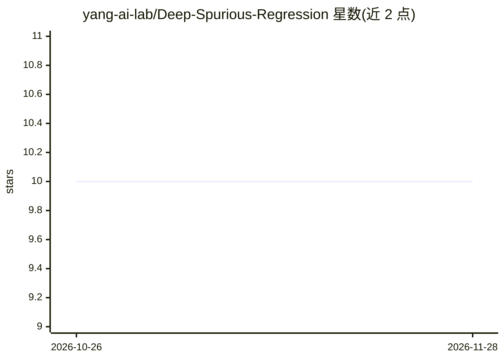

# yang-ai-lab/Deep-Spurious-Regression

⭐ 10 · Python · MIT · 推送 2026-06-02 · [GitHub](https://github.com/yang-ai-lab/Deep-Spurious-Regression) · [官网](https://yang-ai-lab.github.io/Deep-Spurious-Regression/) · 组织维护

**深度伪回归（DSR）论文代码库：复现回归捷径去偏方法的推理评估**

对应论文《Shortcut to Nowhere: Demystifying Deep Spurious Regression》的官方代码库，定义并研究回归任务中的属性-标签混杂（DSR）问题，提出 LMDS、FMDS 及其组合策略，在视觉、环境感知与 LLM 回归任务上实验。当前仓库为轻量版本，仅覆盖 UTKFace 数据集的推理与评估：从 HuggingFace 下载 checkpoint 后用 evaluate 脚本复现论文指标；完整训练代码待论文接收后发布。

## 筛选速览

| 维度 | 判定 | 备注 |
|---|---|---|
| AI 角色 | `ai-native` | 本体是模型或模型工具 |
| 许可风险 | `permissive` | MIT |
| 部署形态 | `library` | 以包/库形式分发 |
| 模型依赖 | — | README 未给出锁定关系 |
| 硬件要求 | — | 无带数字的原话,不猜 |
| 安装摩擦 | `low` | 无编译、无系统依赖或容器化 |
| 成熟度 | `idea` | |

## 能力要点

- 提供 UTKFace 上 LMDS/FMDS/LMDS+FMDS 三个 checkpoint 的推理评估脚本
- 通过 download_and_evaluate.py 一条命令自动下载并复现论文结果
- checkpoint 托管于 HuggingFace，支持 Python API 与 CLI 两种下载方式
- 实验横跨计算机视觉、环境感知与 LLM 回归三类任务

## 适用场景

- 复现论文中 UTKFace 年龄回归的 L1 误差指标
- 在自己的回归数据上检验属性-标签混杂对模型的影响
- 研究分类与回归场景下伪相关捷径的差异

## 场景标签

`科研工具` · 领域:学习与行业

## 证据(README 行号)

> L10: We define **Deep Spurious Regression (DSR)** as learning from regression data with attribute-label confounding, add
> L101: Test L1 errors (↓ lower is better) for our proposed methods — **LMDS**, **FMDS**, and **LMDS+FMDS** — on UTKFace.

## 星数曲线

2026-10-26 10 → 2026-11-28 10（+0）

---
*卡片 v1 · prompt 1.4 · 生成 2026-11-19 · 置信度 mid · 依据 README sha `92f195603b6e` · [字段定义](../../DATASET.md)*
