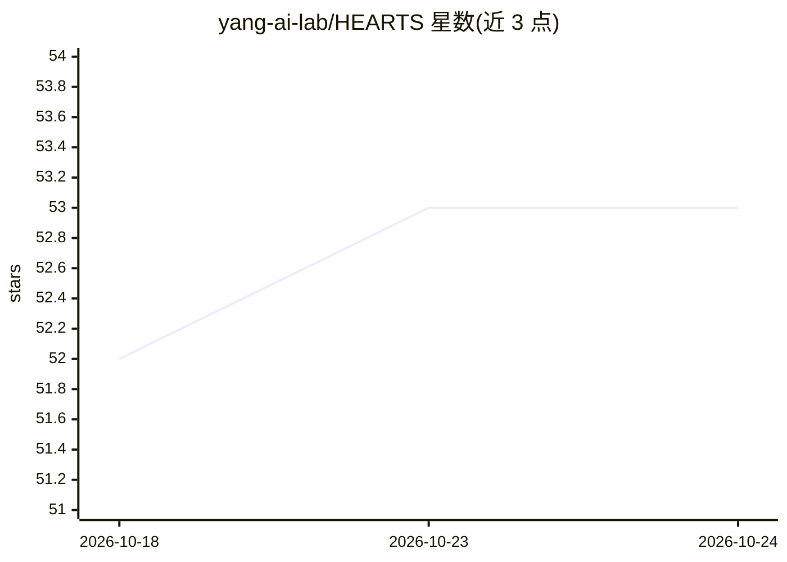

# yang-ai-lab/HEARTS

⭐ 53 · Python · 推送 2026-06-29 · [GitHub](https://github.com/yang-ai-lab/HEARTS) · [官网](https://yang-ai-lab.github.io/HEARTS/) · 组织维护

**评测 LLM agent 在健康时间序列上推理能力的基准框架**

HEARTS 是一个面向真实健康时间序列数据的 LLM agent 推理评测基准与实验框架，覆盖感知、推断、生成、演绎四个层级共 110 个任务，含 16 个数据集、12 个健康领域、20 种信号模态、20,226 条测试样本。内置 CodeAct 等 agent 架构，提供 OpenAI、AWS Bedrock、Google Gemini、XAI 的模型接口，通过 uv 管理依赖，以固定测试用例保证评测可复现，测试用例需从 Hugging Face 下载。需要 Python ≥3.11 与至少一个模型 API key。

## 筛选速览

| 维度 | 判定 | 备注 |
|---|---|---|
| AI 角色 | `ai-ecosystem` | LLM/agent 周边工具 |
| 许可风险 | `none` | — |
| 部署形态 | `None` |  |
| 模型依赖 | locked-api |  |
| 硬件要求 | — | 无带数字的原话,不猜 |
| 安装摩擦 | `low` | 无编译、无系统依赖或容器化 |
| 成熟度 | — | 结构信号不足 |

## 能力要点

- 四层级能力评测：Perception/Inference/Generation/Deduction，共 110 个任务
- 16 个数据集、12 个健康领域、20,226 条测试样本
- 内置 CodeAct agent 与多家 LLM 提供商接口
- 固定测试用例的冻结式实验执行保证可复现

## 适用场景

- 评测 LLM agent 在 ECG/CGM/语音等健康时序数据上的推理能力
- 复现论文实验或提交结果到排行榜
- 基于模块化结构添加自定义数据集实验与新 agent

## 场景标签

`模型评测` · 领域:评测与运维

## 证据(README 行号)

> L7: **HEARTS (Health Reasoning over Time Series)** is a benchmark and evaluation framework for testing how well LLM agen
> L67: - **Model support**: interfaces for major LLM providers (OpenAI, AWS Bedrock, Google Gemini, XAI).

## 星数曲线

2026-10-18 52 → 2026-10-24 53（+1）

---
*卡片 v1 · prompt 1.4 · 生成 2026-10-24 · 置信度 high · 依据 README sha `1cc471dd7841` · [字段定义](../../DATASET.md)*
