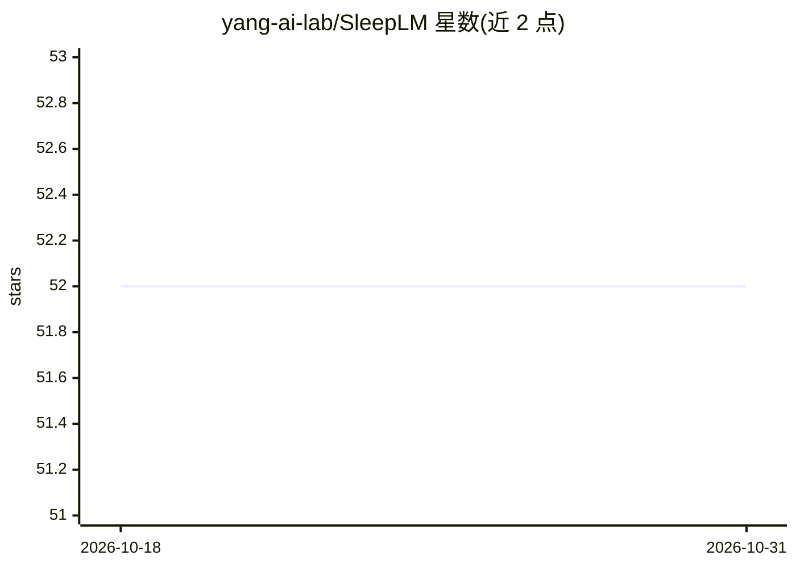

# yang-ai-lab/SleepLM

⭐ 52 · Jupyter Notebook · MIT · 推送 2026-10-07 · [GitHub](https://github.com/yang-ai-lab/SleepLM) · [官网](https://yang-ai-lab.github.io/SleepLM) · 组织维护

**面向多导睡眠图（PSG）的睡眠-语言基础模型：文本生成与跨模态检索**

SleepLM 是在 10,000+ 人、100K+ 小时 PSG（五个 NSRR 队列）的配对睡眠-文本语料上训练的睡眠-语言基础模型族，结合对比对齐、字幕生成与信号重建。用户可对 30 秒睡眠 epoch 按模态（脑/心/呼吸/体动）做可控字幕生成，或利用共享嵌入空间做睡眠-文本检索与零样本/少样本泛化。仓库仅含推理：git clone 安装、从 HuggingFace 下载 checkpoint、在 demo.ipynb 中运行；训练管线尚未开源，NSRR 训练数据因凭据问题不开放，需自行申请。输入需重采样到 64 Hz、z-score 归一化的 10 通道张量 [N,10,1920]。

## 筛选速览

| 维度 | 判定 | 备注 |
|---|---|---|
| AI 角色 | `ai-native` | 本体是模型或模型工具 |
| 许可风险 | `permissive` | MIT |
| 部署形态 | `library` | 以包/库形式分发 |
| 模型依赖 | — | README 未给出锁定关系 |
| 硬件要求 | — | 无带数字的原话,不猜 |
| 安装摩擦 | `low` | 无编译、无系统依赖或容器化 |
| 成熟度 | — | 结构信号不足 |

## 能力要点

- 100K+ 小时 PSG、10,000+ 人配对睡眠-文本语料训练的基础模型
- 按模态（brain/cardiac/respiration/somatic）的可控字幕生成
- 共享信号-文本嵌入空间支持跨模态检索与零/少样本泛化
- ICML 2026 Spotlight 论文，MIT 许可

## 适用场景

- 为自己的多导睡眠记录生成自然语言摘要与描述
- 用文本查询检索相似睡眠信号片段
- 在未见概念上做零样本睡眠理解实验

## 场景标签

`多模态` `语义搜索` · 领域:知识与检索

## 证据(README 行号)

> L7: SleepLM is the first sleep-language foundation model family that enables targeted natural language generation from m
> L19: - **Targeted caption generation** for 30-second sleep epochs using modality tokens (brain / cardiac / respiration /

## 星数曲线

2026-10-18 52 → 2026-10-31 52（+0）

---
*卡片 v1 · prompt 1.4 · 生成 2026-10-24 · 置信度 mid · 依据 README sha `136c0709714b` · [字段定义](../../DATASET.md)*
