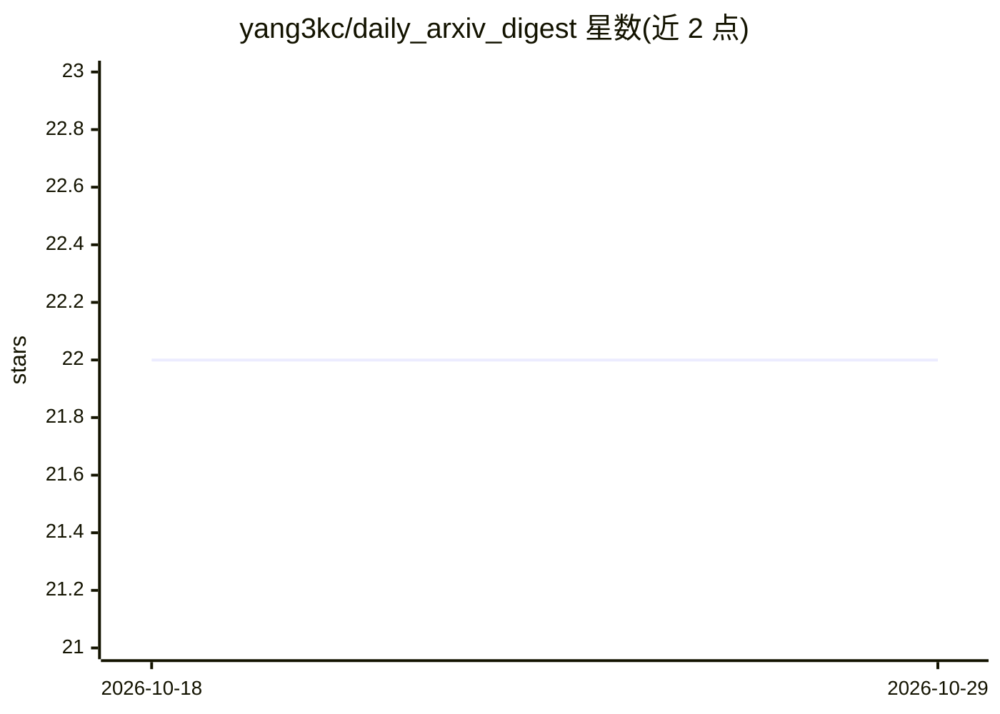

# yang3kc/daily_arxiv_digest

⭐ 22 · Python · MIT · 推送 2026-09-17 · [GitHub](https://github.com/yang3kc/daily_arxiv_digest) · 个人维护

**每日自动生成 arXiv 论文摘要的工具：LLM 筛选并评分**

提供两种形态：一是无人值守的 cron 流水线，拉取最新 arXiv RSS，调用 LLM（OpenAI/Anthropic/OpenRouter 三选一）对论文与用户兴趣主题的相关性评分，输出 JSON 摘要与可选 Markdown 渲染，支持按阈值重新渲染且 TL;DR 缓存以节省 API 调用；二是零依赖的 agent 技能（SKILL.md 格式），由 Claude Code 等 agent 自行拉取并判断相关性，无需 API key。作者声明主要供个人使用，不保证稳定性。

## 筛选速览

| 维度 | 判定 | 备注 |
|---|---|---|
| AI 角色 | `ai-native` | 本体是模型或模型工具 |
| 许可风险 | `permissive` | MIT |
| 部署形态 | `library` | 以包/库形式分发 |
| 模型依赖 | locked-api |  |
| 硬件要求 | — | 无带数字的原话,不猜 |
| 安装摩擦 | `low` | 无编译、无系统依赖或容器化 |
| 成熟度 | `idea` | |

## 能力要点

- cron 无人值守流水线，支持 OpenAI/Anthropic/OpenRouter 三种 LLM 提供商
- 输出结构化 JSON 摘要与原始评分文件，可任意阈值重过滤且不重复花费 API 调用
- 零依赖 agent 技能：仅标准库 Python 脚本，由 agent 自行判断相关性
- 技能兼容 Claude Code 插件市场安装与 npx skills CLI 安装

## 适用场景

- 每天 cron 自动生成我关注主题的 arXiv 论文摘要
- 让 Claude Code 等 agent 按需拉取并筛选今日 arXiv 论文
- 对已评分结果按不同阈值重新筛选论文

## 场景标签

`科研工具` · 领域:学习与行业

## 证据(README 行号)

> L6: This tool fetches the latest arXiv papers, uses an LLM to rate their relevance to the topics of your interest, and w
> L10: - **Daily digest pipeline** (this section and below) — the full pipeline with its own LLM calls, designed to run un

## 星数曲线

2026-10-18 22 → 2026-10-29 22（+0）

---
*卡片 v1 · prompt 1.4 · 生成 2026-10-28 · 置信度 mid · 依据 README sha `6d83678f6826` · [字段定义](../../DATASET.md)*
