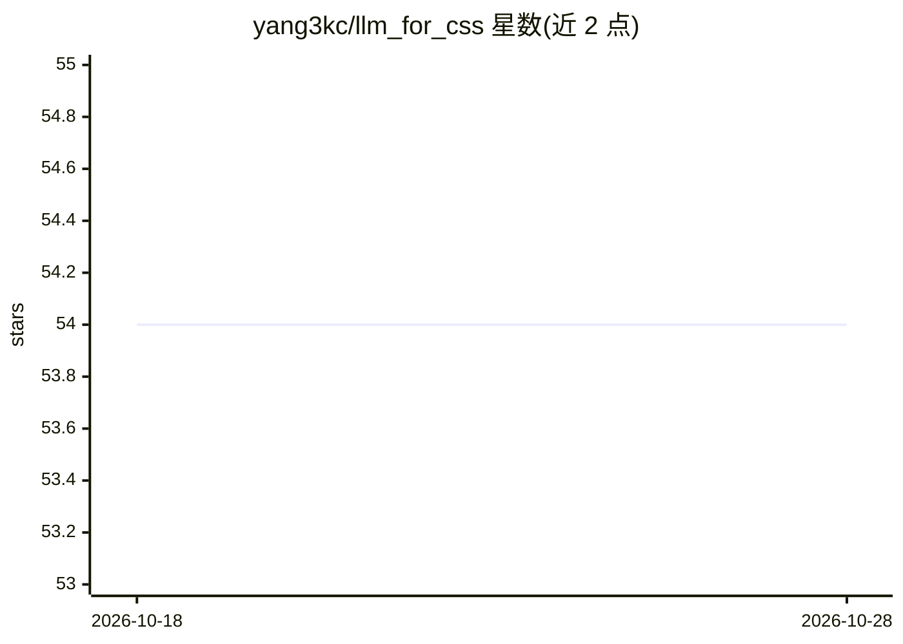

# yang3kc/llm_for_css

⭐ 54 · Python · MIT · 推送 2026-10-01 · [GitHub](https://github.com/yang3kc/llm_for_css) · [官网](https://yang3kc.github.io/llm_for_css/) · 个人维护

**面向计算社会科学研究者的 LLM API 使用教程网站**

由 Kaicheng Yang 维护的教程项目：以 MkDocs 网站为正式版本，仓库存放源码，含 Jupyter notebook、脚本与批处理数据文件。内容覆盖从首次 API 调用到批处理、异步编程、结构化输出，直至数万条文本的低成本处理；接入途径包括 OpenAI、Anthropic API、经 OpenRouter 的开源模型，以及用 Ollama 在笔记本和 GPU 工作站上运行本地 LLM。每章带 Colab 徽章，依赖用 uv 管理，站点经 GitHub Actions 部署到 GitHub Pages。

## 筛选速览

| 维度 | 判定 | 备注 |
|---|---|---|
| AI 角色 | `ai-knowledge` | 知识聚合/清单类 |
| 许可风险 | `permissive` | MIT |
| 部署形态 | `None` |  |
| 模型依赖 | — | README 未给出锁定关系 |
| 硬件要求 | — | 无带数字的原话,不猜 |
| 安装摩擦 | `low` | 无编译、无系统依赖或容器化 |
| 成熟度 | — | 结构信号不足 |

## 能力要点

- 从首次 API 调用到数万条消息的异步与批处理处理流程
- 覆盖 OpenAI、Anthropic、OpenRouter 开源模型与 Ollama 本地 LLM
- 每章为可运行的 Jupyter notebook，附 Colab 徽章
- uv 管理依赖，GitHub Pages 自动部署站点

## 适用场景

- 计算社会科学研究者学习调用 LLM API 处理文本数据
- 在 Colab 上直接运行教程章节的示例
- 搭建本地或低成本的大规模文本处理流水线

## 场景标签

`教程课程` `科研工具` · 领域:学习与行业

## 证据(README 行号)

> L1: # LLM for Computational Social Science
> L3: Runnable guidance and examples for using LLM APIs in computational social science research, from a first API call to
> L5: **Read the tutorial on the website: https://yang3kc.github.io/llm_for_css/**

## 星数曲线

2026-10-18 54 → 2026-10-28 54（+0）

---
*卡片 v1 · prompt 1.4 · 生成 2026-10-24 · 置信度 high · 依据 README sha `0b4bac60a230` · [字段定义](../../DATASET.md)*
