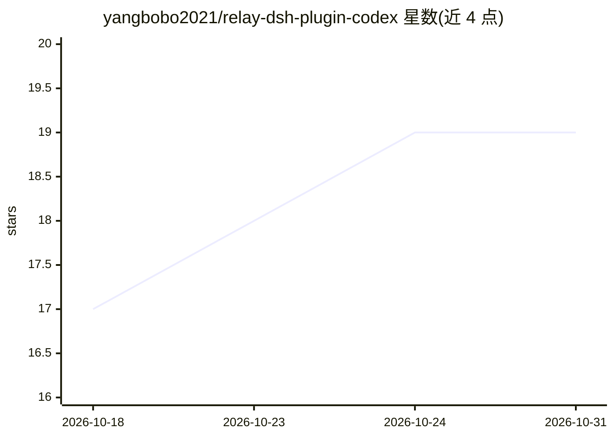

# yangbobo2021/relay-dsh-plugin-codex

⭐ 19 · JavaScript · MIT · 推送 2026-09-19 · [GitHub](https://github.com/yangbobo2021/relay-dsh-plugin-codex) · [官网](https://www.npmjs.com/package/relay-dsh-plugin-codex) · 个人维护 · 中文 README

**为 DeepSeek Harness 接入 Codex 对话后端的插件**

面向 DeepSeek Harness（DSH）Web UI 的插件，将 Codex 注册为原生对话后端：每个 DSH Session 持续对应一个 Codex App Server Thread，保留 DSH 的 workspace、会话历史、审批与工具流程；支持模型与推理力度选择、流式输出、图片与中断续续。插件内置 @openai/codex 运行时（macOS/Windows/Linux x64 与 arm64 二进制），仍需官方 Codex 客户端认证；安装要求 Node.js 22.13+ 与 pnpm，经 npm 或 GitHub 引用安装。

## 筛选速览

| 维度 | 判定 | 备注 |
|---|---|---|
| AI 角色 | `ai-ecosystem` | LLM/agent 周边工具 |
| 许可风险 | `permissive` | MIT |
| 部署形态 | `desktop` | 安装包/桌面程序 |
| 模型依赖 | locked-api |  |
| 硬件要求 | — | 无带数字的原话,不猜 |
| 安装摩擦 | `low` | 无编译、无系统依赖或容器化 |
| 成熟度 | `idea` | |

## 能力要点

- 每个 DSH Session 绑定一个持久 Codex App Server Thread
- 内置 @openai/codex@0.155.1 官方运行时，含三平台 x64/arm64 二进制
- 支持导入已有 Codex 会话并维护一对一绑定
- DSH MCP 工具经 relay_mcp__ 别名在 enhanced 模式下可用

## 适用场景

- 在 DSH 内直接使用 Codex 而不切换到独立界面
- 保留 DSH 原生历史与审批流程的同时运行 Codex 会话
- 将既有 Codex Thread 导入 DSH 工作区继续对话

## 场景标签

`编码 Agent` `聊天机器人` · 领域:编码与开发

## 证据(README 行号)

> L28: `relay-dsh-plugin-codex` adds **Codex as a native conversation backend** to the
> L31: approvals, and tools while each DSH Session continues one Codex App Server

## 星数曲线

2026-10-18 17 → 2026-10-31 19（+2）

---
*卡片 v1 · prompt 1.4 · 生成 2026-10-28 · 置信度 high · 依据 README sha `fd5e57fa692b` · [字段定义](../../DATASET.md)*
