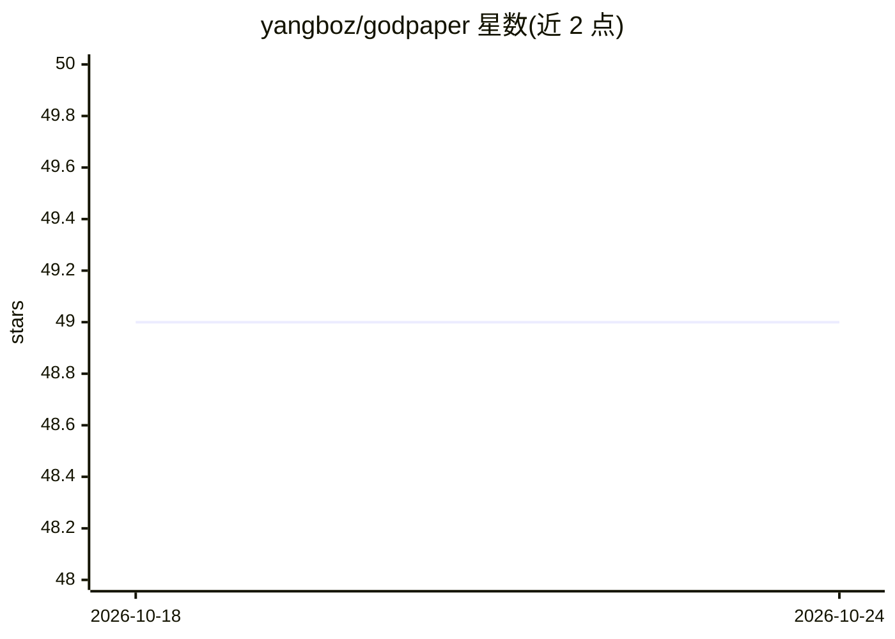

# yangboz/godpaper

⭐ 49 · HTML · NOASSERTION · 推送 2026-02-20 · [GitHub](https://github.com/yangboz/godpaper) · [官网](http://godpaper.cn) · 个人维护

**多语言实现的棋类游戏框架，面向示例学习开发者**

以 AS3 与 Objective-C 实现的 Flash/iOS 棋类与桌面游戏框架，代号 TheRealKnight/TheRealBishop，内含中国象棋等多种基于 Flex MXML 与 Starling/Feathers 的示例游戏。当前版本实现无信息搜索、模拟进化等经典 AI 与跨平台部署，路线图列出神经网络、智能体与深度学习（TensorFlow）方向。提供 Maven 仓库、Jenkins CI、源码 zip 下载与 ASDOC 文档，供偏好通过完整示例学习的开发者使用。

## 筛选速览

| 维度 | 判定 | 备注 |
|---|---|---|
| AI 角色 | `ai-ecosystem` | LLM/agent 周边工具 |
| 许可风险 | `none` | NOASSERTION |
| 部署形态 | `None` |  |
| 模型依赖 | — | README 未给出锁定关系 |
| 硬件要求 | — | 无带数字的原话,不猜 |
| 安装摩擦 | `low` | 无编译、无系统依赖或容器化 |
| 成熟度 | `idea` | |

## 能力要点

- AS3 与 Objective-C 双语言实现的棋类游戏框架
- 路线图含经典 AI（搜索/进化）与神经网络、深度学习方向
- 附多种基于 Flex MXML 与 Starling/Feathers 的示例游戏
- 提供 Maven 仓库与 ASDOC 文档

## 适用场景

- 通过完整示例学习棋类游戏开发
- 基于框架开发中国象棋等桌面棋类游戏
- 了解经典 AI 算法在棋类游戏中的应用

## 场景标签

 · 领域:游戏/软件开发框架

## 证据(README 行号)

> L4: A flash & ios board game framework named GODPAPER(code name:"the real knight"&"the real bishop") by as3 & objective-
> L82: This wiki is for programmers. More precisely, it's for programmers who favor the 'learn by example' approach.

## 星数曲线

2026-10-18 49 → 2026-10-24 49（+0）

---
*卡片 v1 · prompt 1.4 · 生成 2026-10-24 · 置信度 mid · 依据 README sha `deb1b6b4617d` · [字段定义](../../DATASET.md)*
