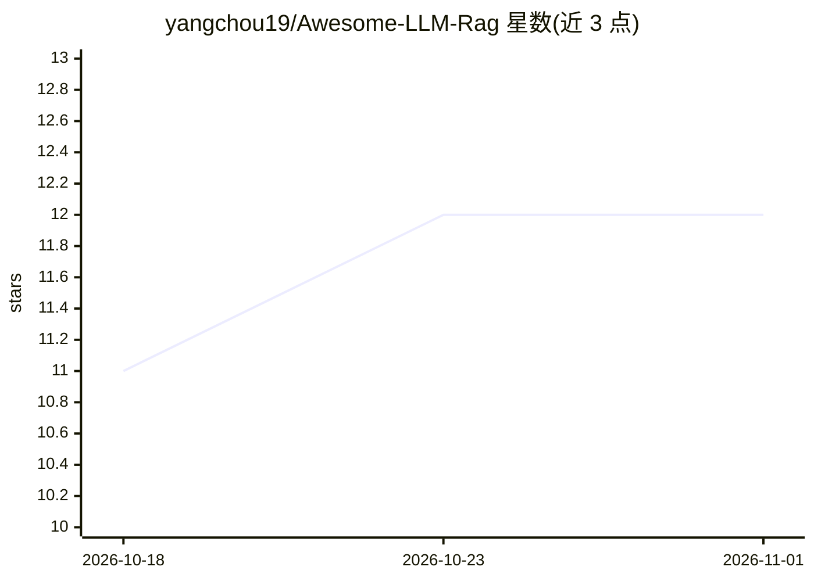

# yangchou19/Awesome-LLM-Rag

⭐ 12 · 推送 2026-08-25 · [GitHub](https://github.com/yangchou19/Awesome-LLM-Rag) · 个人维护

**RAG 领域论文与资源策展清单，面向 LLM 研究者与开发者**

面向 RAG（检索增强生成）方向的资源聚合仓库：收录按 Survey、Framework、Retrieval、Generation、Augmentation、Applications、Evaluation 分类的论文条目，每条含 arXiv 链接、日期、代码仓库与推荐星级；另整理 RAG 教程博客、9 个向量数据库与 8 个工具的对比表格（描述/优缺点）。面向希望系统了解 RAG 研究进展与实践工具的科研人员和开发者，条目通过社区 PR 持续更新，采用 CC0 许可。

## 筛选速览

| 维度 | 判定 | 备注 |
|---|---|---|
| AI 角色 | `ai-knowledge` | 知识聚合/清单类 |
| 许可风险 | `none` | — |
| 部署形态 | `None` |  |
| 模型依赖 | — | README 未给出锁定关系 |
| 硬件要求 | — | 无带数字的原话,不猜 |
| 安装摩擦 | `low` | 无编译、无系统依赖或容器化 |
| 成熟度 | — | 结构信号不足 |

## 能力要点

- 按 7 个技术类别组织的 RAG 论文清单，含代码链接与推荐星级
- 9 个向量数据库（ChromaDB/FAISS/Milvus 等）优缺点对比表
- 8 个 RAG 相关工具（LangChain/LlamaIndex 等）对比表
- 收录 Pinecone/DataStax/Databricks 等厂商的 RAG 教程与博客

## 适用场景

- 系统查找 RAG 各技术环节的代表性论文与开源代码
- 选型时对比向量数据库和 RAG 框架的优缺点
- 入门 RAG 时按教程博客指引学习架构与最佳实践

## 场景标签

`精选清单` · 领域:学习与行业

## 证据(README 行号)

> L5: A curated list of awesome resources for Retrieval-Augmented Generation (RAG) in Large Language Models. Each resource
> L13: ## 📖 Papers

## 星数曲线

2026-10-18 11 → 2026-11-01 12（+1）

---
*卡片 v1 · prompt 1.4 · 生成 2026-11-01 · 置信度 high · 依据 README sha `65ffa026b576` · [字段定义](../../DATASET.md)*
