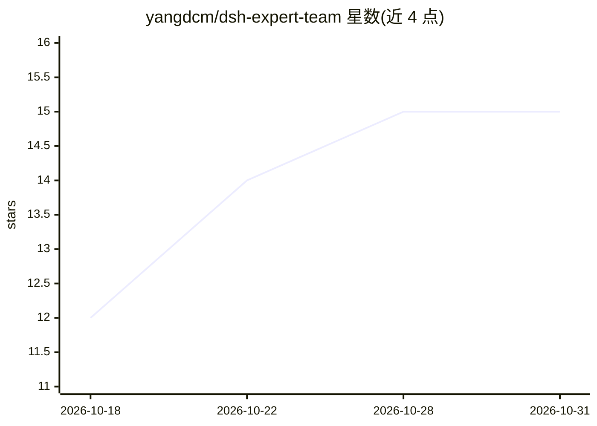

# yangdcm/dsh-expert-team

⭐ 15 · JavaScript · MIT · 推送 2026-09-27 · [GitHub](https://github.com/yangdcm/dsh-expert-team) · [官网](https://dsh-plugin.org/zh/plugins/yangdcm/dsh-expert-team) · 个人维护 · 中文 README

**DeepSeek Harness 的 12 角色多智能体编排插件，一句话组队交付代码**

运行在 DeepSeek Harness（≥0.1.5-rc.1，web profile）上的 dsh 插件：`/team <一句话目标>` 自动拉起产品/架构/前后端/安全/评审/测试等 12 个角色 subagent，按 9 阶段门控流水线（含规格评审硬门、方案确认门）协作，实现者直接修改工作区代码，过程留痕为 SPEC/PLAN/TASKS/REVIEW 等可复核工件。质量门禁由插件代码强制而非提示词。零运行时依赖、无构建步骤，面向中小团队与个人接单者；Hindsight/Midas 等插件为可选推荐。

## 筛选速览

| 维度 | 判定 | 备注 |
|---|---|---|
| AI 角色 | `ai-ecosystem` | LLM/agent 周边工具 |
| 许可风险 | `permissive` | MIT |
| 部署形态 | `library` | 以包/库形式分发 |
| 模型依赖 | locked-api |  |
| 硬件要求 | — | 无带数字的原话,不猜 |
| 安装摩擦 | `low` | 无编译、无系统依赖或容器化 |
| 成熟度 | — | 结构信号不足 |

## 能力要点

- 12 角色各带人设、toolFilter 工具边界与 maxDepth:1 委派深度
- 9 阶段门控流水线，实现阶段按依赖 DAG 并行扇出
- 质量门禁由插件代码强制（lib/interception.js），违规实时显示
- 90 个测试文件，零运行时依赖、无构建步骤与安装钩子

## 适用场景

- 一句话拉起多角色团队完成带登录的支付模块这类完整交付
- 个人接单/外包交付时把 12 个技术部岗位编织进一条流程
- 长任务中需要独立角色做评审与测试验证的场景

## 场景标签

`多智能体` `编码 Agent` · 领域:Agent 开发

## 证据(README 行号)

> L17: 装在 DeepSeek Harness 上的 dsh 插件：**零运行时依赖、无构建步骤、无安装钩子**。
> L86: > dsh 插件 · DeepSeek Harness 多智能体（multi-agent）编排器：角色化 subagent 团队 · 依赖 DAG 并行 · 阶段门控 · 质量门禁 · 工件留痕。
> L312: **它到底是什么？** 一个装在本机 `dsh` 上的插件：`/team <一句话目标>` 会拉起一支 12 角色的 subagent 团队（产品 / 架构 / 调研 / UI / 前后端 / 数据 / 安全 / 评审 / 测试

## 星数曲线

2026-10-18 12 → 2026-10-31 15（+3）

---
*卡片 v1 · prompt 1.4 · 生成 2026-10-30 · 置信度 mid · 依据 README sha `8c498644a1c6` · [字段定义](../../DATASET.md)*
