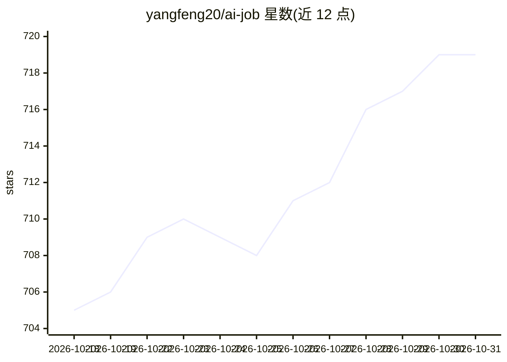

# yangfeng20/ai-job

⭐ 719 · Java · MIT · 推送 2026-08-18 · [GitHub](https://github.com/yangfeng20/ai-job) · 个人维护 · 中文 README

**面向 BOSS 直聘求职者的 AI 自动投递与智能回复油猴脚本+后端**

前后端分离项目：前端为基于 vite-plugin-monkey 的油猴脚本，注入 Boss 直聘页面提供功能面板；后端为 Spring Boot 3 + Spring AI，支持多模型池化管理，通过自研 WebSocket Hook 拦截并解析 Boss 直聘 Protobuf 协议。AI 坐席以 DeepSeek+ChatGPT 赋能，结合简历信息智能回复 HR、批量投递、发送简历、交换联系方式、HR 拒绝挽留，并提供邮件通知。支持个人自用部署与商业运营（内置支付宝支付）。官方托管服务器计划 2026 年 4 月左右关停，已支持本地投递。

## 筛选速览

| 维度 | 判定 | 备注 |
|---|---|---|
| AI 角色 | `ai-native` | 本体是模型或模型工具 |
| 许可风险 | `permissive` | MIT |
| 部署形态 | `None` |  |
| 模型依赖 | locked-api |  |
| 硬件要求 | — | 无带数字的原话,不猜 |
| 安装摩擦 | `low` | 无编译、无系统依赖或容器化 |
| 成熟度 | — | 结构信号不足 |

## 能力要点

- AI 坐席结合简历信息智能回复 HR，支持预设问题与拒绝挽留
- 批量投递简历，支持公司/职位/薪资等自定义筛选
- 高意向职位与每轮沟通的邮件通知
- 油猴脚本注入 Boss 直聘界面 + Spring Boot 3/Spring AI 后端，协议层拦截 Protobuf 通讯

## 适用场景

- 求职时让 AI 分身 7x24 小时自动回复 HR 并批量投递简历
- 设置关键字或对话轮数，接收高意向职位邮件提醒
- 作为服务商部署后向求职者提供 AI 求职服务（内置支付宝支付）

## 场景标签

`浏览器自动化` · 领域:效率与自动化

## 证据(README 行号)

> L48: - **`找工作，用AI工作猎手！让AI帮您找工作！`** AI坐席：【DeepSeek+ChatGpt】赋能，ai助理作为您的求职者分身24小时 * 7在线找工作，并结合您的简历信息定制化回复。批量投递，自动发送简历，交换联系方
> L72: - \- 让AI作为您的求职者分身，帮助您快速找到工作。

## 星数曲线

2026-10-18 705 → 2026-10-31 719（+14）

---
*卡片 v1 · prompt 1.4 · 生成 2026-10-21 · 置信度 high · 依据 README sha `204a6e86ddfd` · [字段定义](../../DATASET.md)*
