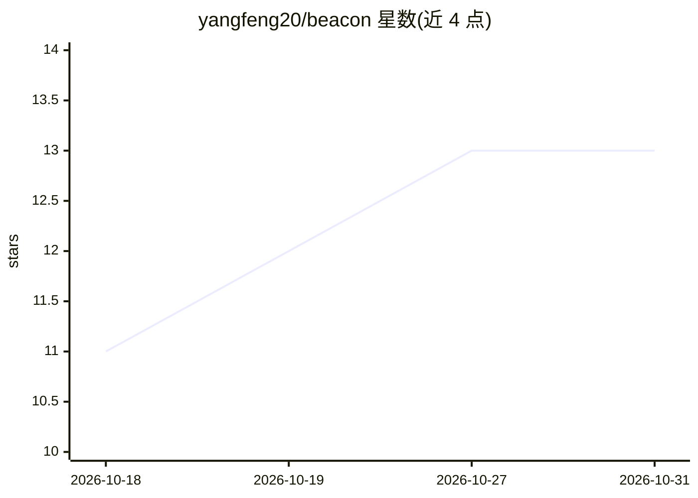

# yangfeng20/beacon

⭐ 13 · 推送 2026-08-11 · [GitHub](https://github.com/yangfeng20/beacon) · 个人维护 · 中文 README

**Windows 桌面 AI 面试助手：记录、复盘、模拟面试**

面向求职者的 Windows 10/11 桌面应用，功能覆盖：AI 辅助整理项目素材（提供提示词配合 Claude Code/Cursor 等工具读代码仓库，产出简历卡片、面试腹稿、深度解析）、面试双轨录音实时转写与说话人区分、自动生成复盘报告、按公司轮次归档管理记录、答题画像与基于个人知识库的 AI 模拟面试。所有提示词可查看和修改，录音仅存本地（约 460MB/小时），转写文本与报告跟账号走。当前 v0.1.0 公开测试阶段，本仓库提供文档与安装包下载（约 64MB）。

## 筛选速览

| 维度 | 判定 | 备注 |
|---|---|---|
| AI 角色 | `ai-native` | 本体是模型或模型工具 |
| 许可风险 | `none` | — |
| 部署形态 | `None` |  |
| 模型依赖 | — | README 未给出锁定关系 |
| 硬件要求 | — | 无带数字的原话,不猜 |
| 安装摩擦 | `low` | 无编译、无系统依赖或容器化 |
| 成熟度 | `idea` | |

## 能力要点

- 面试官/候选人双轨录音实时转写并自动区分说话人
- 自动生成复盘报告：答漏点、未提知识点、常见追问
- AI 模拟面试基于用户自己的知识库出题并追问
- 所有提示词全文可见可改，录音仅保存在本机

## 适用场景

- 面试后自动转写并生成复盘报告，沉淀每场经验
- 用自己的简历和项目做 AI 模拟面试练习
- 整理项目素材生成简历卡片与面试腹稿
- 按公司轮次统一管理全部面试记录

## 场景标签

`AI 助手` `语音识别` `RAG` · 领域:对话与助手

## 证据(README 行号)

> L85: 面试官和你的声音分两轨采集，实时转写，自动区分说话人。不用记笔记，
> L92: 这不是录音转文字——转写只是原料，报告是分析。面试结束后自动生成，
> L121: 八股文「看懂了」和「能开口讲出来」是两码事。AI 面试官**基于你自己的知识库

## 星数曲线

2026-10-18 11 → 2026-10-31 13（+2）

---
*卡片 v1 · prompt 1.4 · 生成 2026-10-31 · 置信度 high · 依据 README sha `1ad52c16f5f3` · [字段定义](../../DATASET.md)*
