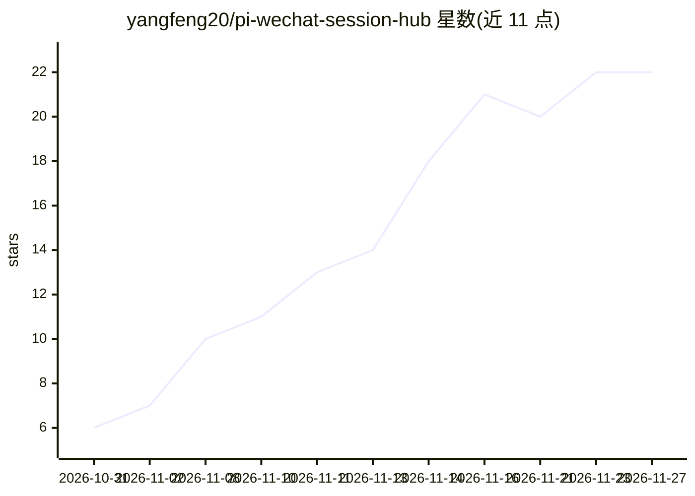

# yangfeng20/pi-wechat-session-hub

⭐ 22 · TypeScript · AGPL-3.0 · 推送 2026-11-19 · [GitHub](https://github.com/yangfeng20/pi-wechat-session-hub) · 个人维护 · 中文 README

**用微信远程管理本机多个 Pi 会话的 Pi 扩展**

Pi WeChat Session Hub 是一个 Pi 扩展，通过独立后台 Gateway daemon 让用户在微信端管理本机多个 Pi 编码 agent 会话：远程下发任务并由本机 Pi 执行、结果回到微信；TUI 全部关闭后后台会话仍可继续对话，TUI 打开时自动完成前后台 owner 交接；支持多项目多会话切换、/last 只读回顾上下文（不调模型不耗 token）。安全机制包括授权根目录白名单、未知命令 fail-closed、HMAC IPC 与 ACL 保护。面向使用 Pi 编码 agent 的开发者；可见 UI 模式依赖 Windows 与 Windows Terminal，后台模式可跨平台使用。

## 筛选速览

| 维度 | 判定 | 备注 |
|---|---|---|
| AI 角色 | `ai-ecosystem` | LLM/agent 周边工具 |
| 许可风险 | `viral` | AGPL-3.0 |
| 部署形态 | `desktop` | 安装包/桌面程序 |
| 模型依赖 | — | README 未给出锁定关系 |
| 硬件要求 | — | 无带数字的原话,不猜 |
| 安装摩擦 | `low` | 无编译、无系统依赖或容器化 |
| 成熟度 | — | 结构信号不足 |

## 能力要点

- 独立后台 daemon：关闭全部 Pi TUI 后仍可通过微信收发消息
- 前后台自动交接：TUI 打开即接管、关闭即交回，同一会话始终只有一个 writer
- /last 只读回顾最近一轮对话，不调模型、不耗 token
- 授权根目录白名单、未知命令 fail-closed、审计不记录正文与凭证

## 适用场景

- 离开电脑后用手机微信继续给 Pi agent 下发任务并接收结果
- 同时管理多个项目的多个 Pi 会话并按索引切换
- 切换设备前用 /last 回顾会话上下文再决定下一步

## 场景标签

 · 领域:AI agent 工具/会话管理

## 证据(README 行号)

> L8: Pi WeChat Session Hub 是一个 Pi 扩展, 用微信管理本机多个 Pi 会话. Gateway 在独立后台进程中运行, 不依赖启动命令所在的 Pi TUI.
> L16: - 微信远程下发任务, 由本机 Pi 执行, 结果回到微信

## 星数曲线

2026-10-31 6 → 2026-11-27 22（+16）

---
*卡片 v1 · prompt 1.4 · 生成 2026-11-18 · 置信度 mid · 依据 README sha `122d23cf2df3` · [字段定义](../../DATASET.md)*
